<div align="center">

Université de Perpignan Via Domitia, IUT de Carcassonne<br>
BUT Science des Données, 3e année

<br><br><br>

# Étude de l'implantation des kebabs dans l'agglomération marseillaise

### Ce que la carte des kebabs révèle de la métropole Aix-Marseille-Provence

<br>

*SAÉ 5.EMS.01 : Mener une étude statistique dans un domaine d'application*

<br><br>

Réalisé par Ayi Amavigan et Aboubakar Coulibaly<br>
Encadrant : Sébastien Pinel<br>
Année universitaire 2026-2027<br>
Décembre 2026

</div>



## Sommaire

- [Résumé](#résumé)
- [Glossaire](#glossaire)
- [1. Introduction](#1-introduction)
  - [1.1 Contexte](#11-contexte)
  - [1.2 Problématique](#12-problématique)
  - [1.3 Hypothèses de départ](#13-hypothèses-de-départ)
  - [1.4 Un article de référence](#14-un-article-de-référence)
- [2. Gestion de projet](#2-gestion-de-projet)
  - [2.1 Organisation du groupe](#21-organisation-du-groupe)
  - [2.2 Planning](#22-planning)
- [3. Méthodologie de collecte des données](#3-méthodologie-de-collecte-des-données)
  - [3.1 Périmètre d'étude](#31-périmètre-détude)
  - [3.2 Sources mobilisées](#32-sources-mobilisées)
  - [3.3 Constitution de la base des kebabs](#33-constitution-de-la-base-des-kebabs)
  - [3.4 Gares et stations](#34-gares-et-stations)
  - [3.5 Données socio-démographiques](#35-données-socio-démographiques)
  - [3.6 Limites et biais de la collecte](#36-limites-et-biais-de-la-collecte)
- [4. Analyse exploratoire spatiale](#4-analyse-exploratoire-spatiale)
  - [4.1 Répartition des kebabs](#41-répartition-des-kebabs)
  - [4.2 Carroyage et densité](#42-carroyage-et-densité)
  - [4.3 Rapporter à la population](#43-rapporter-à-la-population)
- [5. Croisement avec les variables socio-démographiques](#5-croisement-avec-les-variables-socio-démographiques)
  - [5.1 Jointure et indicateurs](#51-jointure-et-indicateurs)
  - [5.2 Les kebabs sont plus groupés que la population (H1)](#52-les-kebabs-sont-plus-groupés-que-la-population-h1)
  - [5.3 Corrélations avec les caractéristiques des carreaux (H2)](#53-corrélations-avec-les-caractéristiques-des-carreaux-h2)
  - [5.4 L'âge des habitants, les 25-39 ans plutôt que les étudiants](#54-lâge-des-habitants-les-25-39-ans-plutôt-que-les-étudiants)
  - [5.5 Fractures Nord-Sud et centre-périphérie à Marseille (H4)](#55-fractures-nord-sud-et-centre-périphérie-à-marseille-h4)
  - [5.6 Effet des gares et carte isochrone (H3)](#56-effet-des-gares-et-carte-isochrone-h3)
  - [5.7 Le dicton de la gare (H5)](#57-le-dicton-de-la-gare-h5)
- [6. Modélisation](#6-modélisation)
  - [6.1 Le modèle](#61-le-modèle)
  - [6.2 Ce qui explique la présence d'un kebab](#62-ce-qui-explique-la-présence-dun-kebab)
  - [6.3 Qualité du modèle](#63-qualité-du-modèle)
  - [6.4 Explorer les résultats en 3D](#64-explorer-les-résultats-en-3d)
- [7. Retour et recommandations](#7-retour-et-recommandations)
  - [7.1 Difficultés rencontrées](#71-difficultés-rencontrées)
  - [7.2 Pistes d'amélioration](#72-pistes-damélioration)
- [8. Conclusion](#8-conclusion)
- [Bibliographie et sources](#bibliographie-et-sources)
- [Annexes](#annexes)
  - [A. Diagramme de Gantt prévisionnel](#a-diagramme-de-gantt-prévisionnel)
  - [B. Code source](#b-code-source)
  - [C. Dictionnaire des données](#c-dictionnaire-des-données)
  - [D. Scène 3D interactive](#d-scène-3d-interactive)
  - [E. Kebabs par arrondissement de Marseille](#e-kebabs-par-arrondissement-de-marseille)

### Liste des figures

| N° | Titre | Section |
|---|---|---|
| 1 | Distance au fast-food le plus proche en Nouvelle-Zélande (Pearce et al., 2007) | 1.4 |
| 2 | Les kebabs de la métropole | 4.1 |
| 3 | Les kebabs à Marseille, zoom sur l'hypercentre | 4.1 |
| 4 | Nombre de kebabs par carreau de 200 m | 4.2 |
| 5 | Carte de chaleur des kebabs à Marseille | 4.2 |
| 6 | Nombre de kebabs pour 10 000 habitants | 4.3 |
| 7 | Niveau de vie et implantation des kebabs à Marseille | 5.1 |
| 8 | Corrélations entre kebabs et caractéristiques des carreaux | 5.3 |
| 9 | Jeunes adultes et implantation des kebabs à Marseille | 5.4 |
| 10 | Âge des habitants des carreaux avec et sans kebab | 5.4 |
| 11 | Gares, stations et kebabs à Marseille | 5.6 |
| 12 | Isochrones à pied autour de la gare Saint-Charles | 5.6 |
| 13 | Ce qui explique la présence d'un kebab (modèle) | 6.2 |
| 14 | Diagramme de Gantt prévisionnel | Annexe A |
| 15 | La scène 3D sur Marseille | Annexe D |
| 16 | L'isochrone en mouvement dans la scène 3D | Annexe D |
| 17 | La simulation dans la scène 3D | Annexe D |

### Liste des tableaux

| N° | Titre | Section |
|---|---|---|
| 1 | Sources de données mobilisées | 3.2 |
| 2 | Base finale des kebabs par source et fiabilité | 3.3 |
| 3 | Test de regroupement des kebabs | 5.2 |
| 4 | Carreaux avec et sans kebab à Marseille | 5.3 |
| 5 | Taux de kebabs par groupe d'arrondissements | 5.5 |
| 6 | Distance des kebabs et des habitants aux gares | 5.6 |
| 7 | Kebabs et habitants selon le temps de marche depuis Saint-Charles | 5.6 |
| 8 | Effets estimés par le modèle | 6.2 |
| 9 | Performances du modèle en validation croisée | 6.3 |
| 10 | Base des kebabs : description des colonnes | Annexe C |
| 11 | Indicateurs des carreaux : calcul | Annexe C |
| 12 | Kebabs par arrondissement de Marseille | Annexe E |



## Résumé

Pourquoi trouve-t-on des kebabs à certains endroits de la métropole d'Aix-Marseille-Provence
et pas à d'autres, et que raconte cette carte du territoire ? Aucune liste officielle
n'existant, nous avons construit notre propre base de 144 kebabs à partir d'OpenStreetMap et
du répertoire SIRENE, puis nous l'avons croisée avec les carreaux de 200 m de l'Insee
(Filosofi 2019) et avec les gares et stations. Le résultat est net. Les kebabs sont deux fois
plus regroupés que la population. Ils recherchent les quartiers denses et modestes où vivent
de jeunes actifs, et surtout les abords du métro et du tram : 78 % des kebabs marseillais
sont à moins de 500 m d'une station, contre 39 % des habitants. Notre régression logistique
(AUC de 0,93) place le niveau de vie en tête, devant la densité et la desserte, et fait mieux
que deux modèles plus complexes. La carte des kebabs redessine ainsi la fracture sociale de
Marseille : un centre populaire très fourni, des quartiers Nord intermédiaires, un Sud aisé
qui n'en compte presque pas. Une scène 3D animée permet de rejouer toute l'étude.

Mots-clés : kebab, analyse spatiale, Marseille, Aix-Marseille-Provence, données carroyées,
Insee Filosofi, OpenStreetMap, SIRENE, gares, inégalités socio-spatiales.

## Glossaire

| Terme | Définition |
|---|---|
| Agglomération | Dans cette étude, le territoire de la Métropole d'Aix-Marseille-Provence (92 communes) |
| API | Service en ligne qu'un programme peut interroger pour récupérer des données |
| Carreau Insee | Carré de 200 m de côté pour lequel l'Insee diffuse des statistiques |
| EPCI | Établissement public de coopération intercommunale, ici la métropole |
| Filosofi | Fichier de l'Insee sur les revenus et la pauvreté, issu des données fiscales |
| Isochrone | Zone que l'on peut atteindre depuis un point en un temps donné, par exemple 10 minutes à pied |
| NAF | Nomenclature des activités françaises (56.10C correspond à la restauration rapide) |
| OSM | OpenStreetMap, carte collaborative et libre |
| SIRENE | Répertoire de l'Insee qui recense les entreprises et leurs établissements |
| SIRET | Numéro unique d'un établissement, à 14 chiffres |



# 1. Introduction

## 1.1 Contexte

Le kebab est l'un des commerces de restauration rapide les plus répandus en France. Une
vidéo des Échos, « Ce que la carte des kebabs révèle de Paris », a montré que leur
répartition dans la capitale reflète ses fractures sociales. Sur internet, un dicton fait
aussi débat : « plus c'est près de la gare, moins le kebab est bon ».

L'idée nous a plu, et nous avons voulu la transposer à l'agglomération marseillaise, que nous
prenons ici au sens de la Métropole d'Aix-Marseille-Provence : 92 communes, environ
1,9 million d'habitants et 3 150 km². Le terrain s'y prête, tant il est contrasté. Marseille
(886 000 habitants, 16 arrondissements) est dense et coupée entre ses quartiers Nord et Sud.
Aix-en-Provence est plutôt aisée. L'étang de Berre et Fos-sur-Mer forment des pôles
industriels, et tout autour s'étendent des communes périurbaines ou rurales.

## 1.2 Problématique

> Comment expliquer la répartition spatiale des kebabs dans l'agglomération marseillaise,
> et cette répartition révèle-t-elle d'autres fractures socio-spatiales du territoire ?

## 1.3 Hypothèses de départ

Nous sommes partis de cinq hypothèses, que la suite du rapport met à l'épreuve une à une.

- **H1.** Les kebabs ne sont pas répartis au hasard : ils se concentrent dans quelques zones,
  centres-villes et axes passants, et davantage à Marseille qu'ailleurs.
- **H2.** Leur nombre dépend du profil des habitants : densité, âge, revenus, logement social.
- **H3.** Ils sont plus nombreux près des gares et des stations.
- **H4.** Leur répartition oppose les quartiers Nord et Sud de Marseille, et le centre de la
  métropole à sa périphérie.
- **H5**, en guise d'ouverture : le dicton dit vrai, et les kebabs proches d'une gare sont
  moins bien notés.

## 1.4 Un article de référence

Pour cadrer notre démarche, nous nous sommes appuyés sur un article de géographie de la
santé : *Neighborhood Deprivation
and Access to Fast-Food Retailing: A National Study*, de Pearce, Blakely, Witten et Bartie,
publié en 2007 dans l'*American Journal of Preventive Medicine*.

**Objectif.** Les auteurs se demandent si, en Nouvelle-Zélande, les fast-foods sont plus
faciles d'accès dans les quartiers défavorisés, et si ce lien diffère de celui observé pour
les commerces qui vendent une alimentation plus saine. La question vient de la santé
publique : l'obésité y est deux fois plus fréquente dans les quartiers les plus pauvres, et
l'environnement alimentaire pourrait en être l'une des causes.

**Méthode.** Les auteurs ont obtenu la liste de tous les fast-foods du pays auprès des
74 collectivités chargées des contrôles d'hygiène, puis l'ont vérifiée avec l'annuaire :
2 930 établissements, dont 474 appartiennent à des chaînes multinationales. Pour chacun des
38 350 îlots de recensement (environ 100 habitants chacun), ils calculent la distance par la
route entre le centre de population de l'îlot et le fast-food le plus proche. Les îlots sont
classés en dix groupes selon un indice de défavorisation construit à partir du recensement
(revenus, chômage, accès à une voiture, statut d'occupation du logement…). Les distances
médianes des dix groupes sont comparées par une analyse de variance, en séparant zones
urbaines et rurales, puis à densité de population égale.

**Résultats.** La distance médiane au fast-food le plus proche passe de 1 545 m dans les
quartiers les plus favorisés à 742 m dans les plus défavorisés : elle est au moins deux fois
plus courte dans les quartiers pauvres (p < 0,001). Le constat vaut pour les chaînes comme
pour les fast-foods locaux, et il tient à densité égale. Il s'inverse en revanche à la
campagne, où les îlots les plus pauvres sont aussi les plus isolés.

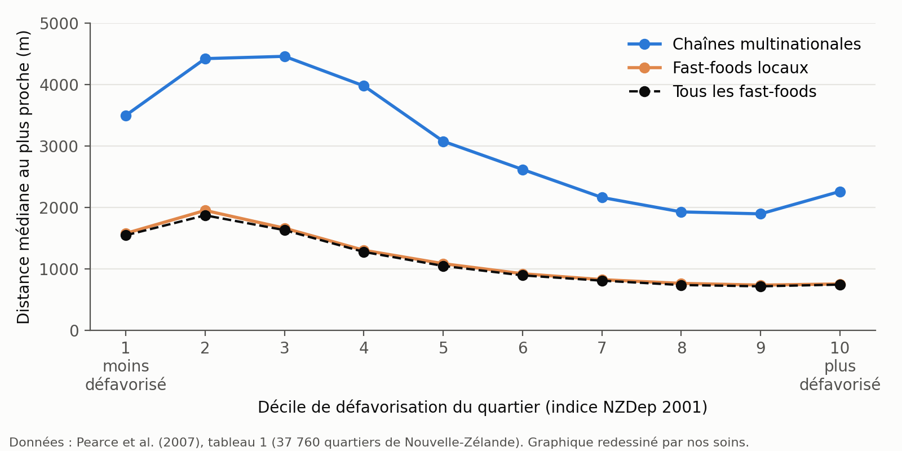

*Figure 1 : distance médiane au fast-food le plus proche selon le niveau de défavorisation du
quartier, en Nouvelle-Zélande (d'après Pearce et al., 2007, tableau 1).*

Nous avons retenu ce graphique parce qu'il résume tout l'article. Chaque point est la
distance médiane d'un dixième des quartiers du pays, des plus favorisés (à gauche) aux plus
défavorisés (à droite). Les trois courbes descendent : plus un quartier est défavorisé, plus
le fast-food le plus proche est près. Les chaînes multinationales, moins nombreuses, sont
toujours plus loin, mais elles suivent la même pente. Seul le premier dixième, le plus
favorisé, fait un peu exception : ses fast-foods sont plus proches que ceux des deux groupes
suivants.

**Discussion.** Les auteurs avancent trois explications : une demande plus forte dans les
quartiers défavorisés, une densité de population plus élevée (mais le lien demeure à densité
égale) et des loyers commerciaux plus bas. Surtout, les supermarchés suivent exactement la
même répartition. On ne peut donc pas parler d'un « ciblage » des quartiers pauvres par la
restauration rapide : ce sont tous les commerces qui y sont plus proches. Les auteurs
reconnaissent aussi que la distance au commerce le plus proche ne dit rien de ce que les
habitants achètent réellement. D'autres travaux nuancent d'ailleurs ce résultat : à Glasgow,
Macintyre et al. (2005) ne trouvent pas de lien aussi net entre pauvreté et restauration
rapide.

Cet article nous a donné trois réflexes, que l'on retrouvera plus loin : travailler à une
échelle très fine (notre carreau de 200 m joue le rôle de leur îlot), mesurer les distances
sur le réseau de rues plutôt qu'à vol d'oiseau (nos isochrones), et vérifier que le lien avec
la pauvreté ne vient pas seulement de la densité (corrélations partielles, puis modèle). Nous
y ajoutons un facteur qu'ils n'avaient pas : les gares et stations, et la clientèle de passage
qu'elles amènent.

# 2. Gestion de projet

## 2.1 Organisation du groupe

| Membre | Rôle principal |
|---|---|
| Ayi Amavigan | Bibliographie et article de référence, croisement avec les données de l'Insee, tests statistiques (partie 5), relecture |
| Aboubakar Coulibaly | Collecte et nettoyage des données, cartes (partie 4), modélisation (partie 6), scène 3D, mise en forme du rapport |

Les choix de méthode (périmètre, hypothèses, définition d'une gare) ont été discutés à deux
en séance, et chacun a relu les parties de l'autre.

Nous travaillons sur un espace commun, un dossier Google Drive partagé qui contient les
scripts, les données et le rapport. Le code est aussi versionné sur un dépôt GitHub public,
ce qui garde l'historique de chaque modification et permet à chacun de relancer toute
l'étude.

## 2.2 Planning

Le diagramme de Gantt prévisionnel, établi sur 30 heures par tranches de 2 heures, est
présenté en annexe A.

# 3. Méthodologie de collecte des données

Première surprise du projet : aucune liste de kebabs n'existe en open data. Il a donc fallu
construire la nôtre, en croisant plusieurs sources. Toute la collecte est écrite en Python et
peut être relancée d'un bout à l'autre (annexe B).

## 3.1 Périmètre d'étude

Notre terrain d'étude est la Métropole d'Aix-Marseille-Provence et ses 92 communes. Pour les
comparaisons entre territoires, nous découpons la ville de Marseille en ses 16 arrondissements,
plus fins que la commune. Cela donne 107 zones de travail : les 91 autres communes et les
16 arrondissements marseillais.

Pour les analyses statistiques, nous descendons à une échelle beaucoup plus fine, celle du
carreau Insee de 200 mètres de côté. La métropole compte 25 957 carreaux habités, dont 3 150
à Marseille. C'est l'échelle la plus fine que diffuse l'Insee, et celle que propose le sujet :
elle permet de distinguer une rue commerçante d'un quartier résidentiel voisin. Nous avons
aussi refait les analyses avec des carreaux de 1 km, en additionnant les petits carreaux :
les conclusions sont les mêmes, avec des corrélations plus fortes car il y a moins de
carreaux vides.

Enfin, un zoom sur la ville de Marseille permet de comparer nos résultats à l'étude
parisienne.

## 3.2 Sources mobilisées

*Tableau 1 : sources de données mobilisées*

| Donnée | Source | Usage |
|---|---|---|
| Limites des communes et arrondissements | API Découpage administratif (IGN, Insee) | Périmètre, regroupements |
| Kebabs | OpenStreetMap, via l'API Overpass | Base de travail |
| Kebabs | Répertoire SIRENE de l'Insee, via l'API Recherche d'entreprises | Base de travail |
| Gares, métro, tram | OpenStreetMap, via l'API Overpass | Calcul de distances |
| Population, revenus, âges, logement | Insee, Filosofi 2019, carreaux de 200 m | Variables explicatives |

## 3.3 Constitution de la base des kebabs

Dans OpenStreetMap, nous retenons les établissements dont la cuisine est déclarée comme
kebab, döner ou shawarma, ainsi que les fast-foods et restaurants dont le nom contient
« kebab » ou « döner ». Nous obtenons ainsi 85 établissements répartis dans 16 communes,
dont 55 à Marseille.

Dans SIRENE, nous cherchons les établissements de restauration encore en activité dont le
nom ou l'enseigne contient un mot-clé. Les mots-clés principaux (kebab, doner, döner, durum)
renvoient 51 établissements. Des mots-clés secondaires, plus incertains, comme Istanbul,
Bosphore, Antalya, Berliner ou Shawarma, en ajoutent 39. Cela fait 90 établissements dans
12 communes, dont 63 à Marseille. Nous avons aussi testé les mots « grill », « snack » et
« tacos », puis nous les avons abandonnés, car ils ramenaient trop de restaurants qui ne
sont pas des kebabs.

Ces deux listes brutes ont ensuite été nettoyées et fusionnées en quatre étapes.

Nous avons d'abord jugé la fiabilité de chaque établissement. Il est considéré comme
certain si son nom contient un mot-clé kebab ou si sa seule cuisine déclarée est le kebab.
Il est considéré comme probable si le kebab n'est qu'une offre parmi d'autres, dans un snack
généraliste par exemple, ou si son nom est seulement évocateur, comme « Istanbul ». Dix
établissements ont été écartés comme faux positifs : la recherche de SIRENE ramenait par
exemple une pizzeria (Pizza King) ou un restaurant de paella, et nous avons retiré à la main
une pâtisserie orientale.

Nous avons ensuite supprimé les doublons à l'intérieur de SIRENE. Quand un local change
d'exploitant, l'ancien établissement reste parfois enregistré comme actif. C'est le cas,
par exemple, de cinq établissements successifs au 18-20 cours Belsunce. Nous avons regroupé
les établissements situés à moins de 30 mètres l'un de l'autre et portant des noms proches,
en gardant le plus récent. Sept doublons ont ainsi été éliminés.

La troisième étape consistait à reconnaître les kebabs présents dans les deux sources. Deux
fiches désignent le même lieu si elles ont le même numéro SIRET, si elles sont à moins de
100 mètres avec des noms proches, ou si elles se trouvent à la même adresse (moins de
10 mètres). La distance seule ne suffit pas, car deux kebabs différents sont parfois voisins.
Nous avons retrouvé 14 kebabs dans les deux sources, dont la moitié grâce au SIRET.

Enfin, nous avons fusionné le tout, à raison d'une ligne par kebab. Lorsqu'un kebab est dans
les deux sources, nous gardons la position donnée par OpenStreetMap, plus précise, car elle
est placée sur le bâtiment et non déduite de l'adresse.

*Tableau 2 : base finale des kebabs selon la source et la fiabilité*

| Source | Certain | Probable | Total |
|---|---|---|---|
| OpenStreetMap seul | 40 | 30 | 70 |
| SIRENE seul | 39 | 21 | 60 |
| Les deux sources | 13 | 1 | 14 |
| Total | 92 | 52 | 144 |

Notre base finale compte 144 kebabs, dont 95 à Marseille et 13 à Aix-en-Provence. Les deux
sources n'ont que 14 kebabs en commun : elles se complètent bien, mais aucune n'est
exhaustive. Nous menons les analyses sur l'ensemble des kebabs, certains et probables, puis
nous vérifions que les résultats tiennent avec les seuls kebabs certains.

Ce faible recouvrement permet aussi d'estimer le nombre réel de kebabs par la méthode de
capture-recapture de Lincoln-Petersen :
$\hat N = \frac{n_{OSM} \times n_{SIRENE}}{n_{commun}} = \frac{84 \times 74}{14} \approx 440$.
Notre base couvrirait donc environ un tiers des kebabs de la métropole. Ce chiffre reste
indicatif, car la méthode suppose que les deux sources sont indépendantes, ce qui est
douteux : un kebab bien visible, avec « kebab » dans son nom, a plus de chances de figurer
dans les deux.

## 3.4 Gares et stations

Nous avons extrait d'OpenStreetMap 42 gares SNCF et TER, 29 stations de métro et 61 arrêts
de tramway (à Marseille et Aubagne). Nous avons aussi gardé cinq gares situées juste en dehors
de la métropole, comme Bandol ou Saint-Martin-de-Crau, car elles peuvent être la gare la plus
proche d'un kebab situé en bordure. La définition même de la « gare » est un choix de
méthode : nous testerons d'abord les gares SNCF seules, puis l'ensemble des stations de
transport en commun.

## 3.5 Données socio-démographiques

Les caractéristiques des habitants proviennent des données carroyées Filosofi 2019 de
l'Insee. Les carreaux de 200 mètres couvrant la métropole regroupent 1 822 434 habitants,
dont 810 486 à Marseille. Chaque carreau est rattaché à la commune, ou à l'arrondissement,
qui contient son centre.

À partir de ces données, nous construisons pour chaque carreau sept indicateurs : la densité
de population, le niveau de vie moyen par habitant, le taux de pauvreté des ménages, la part
de logements sociaux, la part des 18-39 ans, la part des 65 ans et plus, et la distance à la
gare ou à la station la plus proche. Le détail des calculs figure dans le dictionnaire des
données (annexe C).

## 3.6 Limites et biais de la collecte

Cette collecte a ses limites, et mieux vaut les avoir en tête avant de lire les résultats.

D'abord, elle n'est pas exhaustive. OpenStreetMap est une carte collaborative, remplie par
des bénévoles : n'importe qui peut y ajouter ou corriger un restaurant. Pour savoir qui
renseigne nos kebabs, nous avons récupéré l'historique de leurs fiches. Les 85 kebabs ont
été modifiés en dernier par 53 contributeurs différents, mais un seul d'entre eux a mis à
jour 16 fiches, et les trois plus actifs en couvrent près d'un tiers. La source dépend donc
beaucoup de quelques passionnés, souvent plus actifs dans les grandes villes qu'à la campagne.
Les fiches sont en revanche plutôt récentes : 78 % ont été modifiées depuis 2024, même si un
quart n'ont jamais été retouchées depuis leur création, et deux datent de 2012.

SIRENE, de son côté, ne permet de trouver que les kebabs dont le nom contient un mot-clé :
un « Snack du Port » qui vend des kebabs reste invisible.

À l'inverse, la recherche dans SIRENE ramène des restaurants qui ne sont pas des kebabs. Nous
en avons écarté dix, mais les établissements classés comme probables restent incertains.

Les données n'ont pas non plus la même date. OpenStreetMap et SIRENE sont à jour en 2026,
alors que les données Filosofi datent de 2019. Par ailleurs, SIRENE indique si un
établissement est fermé, mais OpenStreetMap ne le fait pas toujours.

S'y ajoute le secret statistique : pour les carreaux très peu peuplés, l'Insee remplace les
vraies valeurs par des estimations.

Enfin, une grande partie de la métropole est rurale ou naturelle. La plupart des carreaux
n'ont donc aucun kebab, ce dont les modèles devront tenir compte.

# 4. Analyse exploratoire spatiale

Toutes les cartes de cette partie sont construites à partir de la base nettoyée de
144 kebabs.

## 4.1 Répartition des kebabs

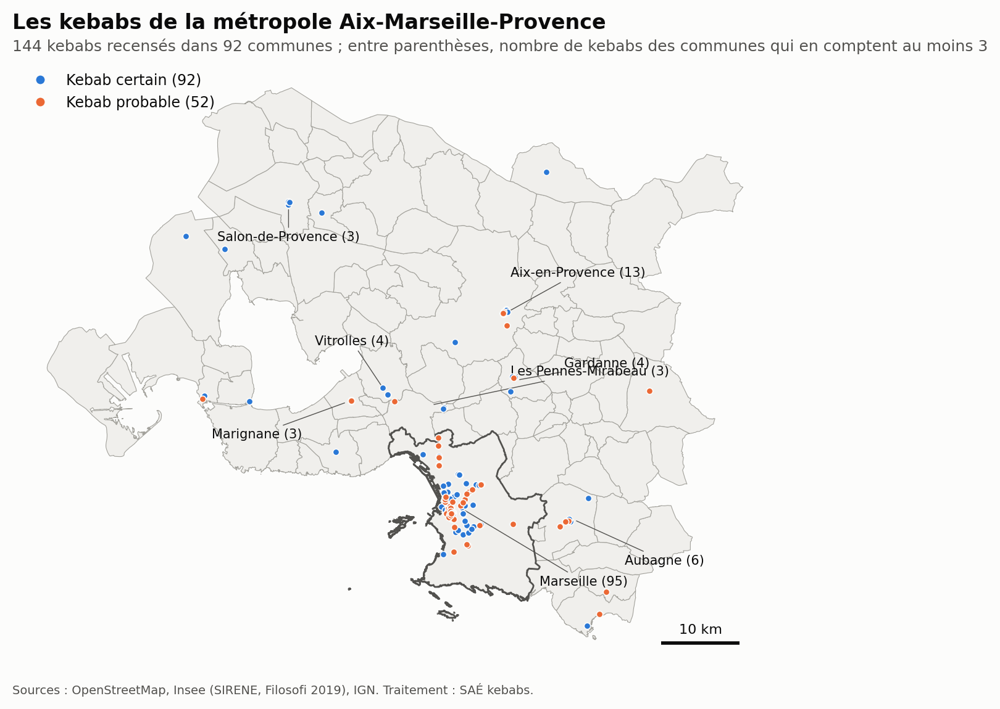

*Figure 2 : les kebabs de la métropole Aix-Marseille-Provence.*

À l'échelle de la métropole, la répartition est très inégale. Marseille concentre 95 des
144 kebabs, soit 66 %, alors qu'elle n'abrite que 46 % de la population. En dehors de
Marseille, seules 17 communes sur 91 comptent au moins un kebab. Il s'agit surtout de villes
moyennes : Aix-en-Provence (13 kebabs), Aubagne (6), Vitrolles et Gardanne (4 chacune). Les
74 communes sans kebab regroupent pourtant 472 000 habitants, principalement dans des
communes périurbaines ou rurales.

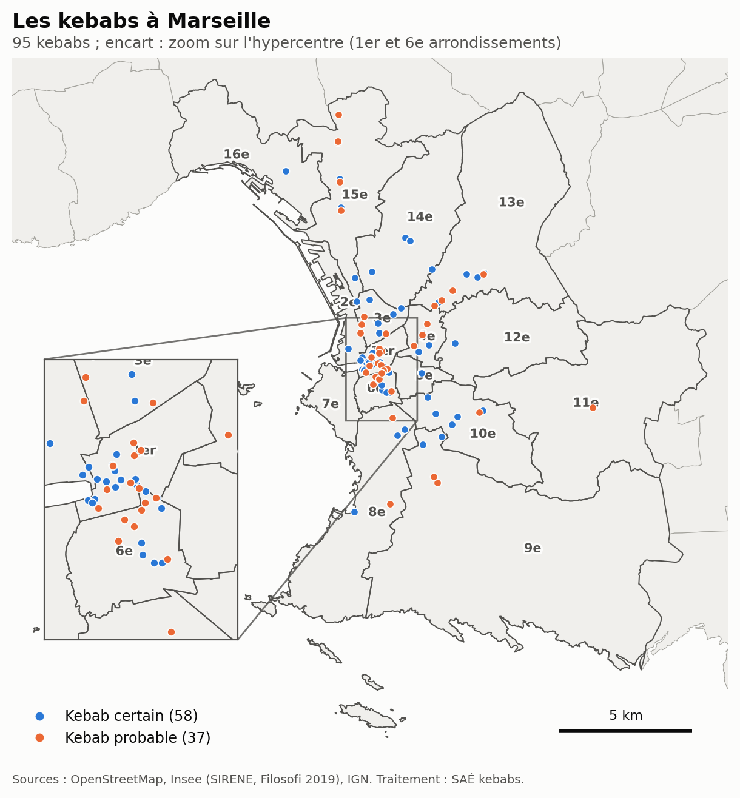

*Figure 3 : les kebabs à Marseille, avec un zoom sur l'hypercentre.*

À Marseille, les kebabs forment un noyau très dense dans les 1er et 6e arrondissements,
autour de la Canebière, de Noailles et du cours Julien. Ils s'étirent ensuite le long de deux
axes, l'un vers le nord (3e, 14e et 15e arrondissements), l'autre vers l'est (4e et 13e). Les
quartiers Sud et Est sont presque vides : on ne compte aucun kebab dans le 7e arrondissement,
et un seul dans le 11e comme dans le 12e.

## 4.2 Carroyage et densité

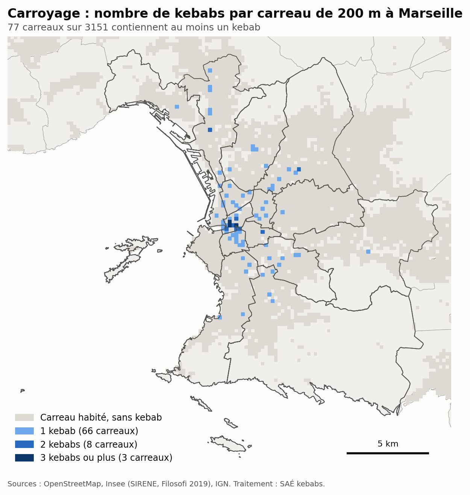

*Figure 4 : nombre de kebabs par carreau de 200 m à Marseille.*

Chaque kebab est ensuite placé dans le carreau Insee de 200 mètres qui le contient. Trois
kebabs se trouvent dans des carreaux sans habitants, comme des zones commerciales : nous
avons ajouté ces carreaux pour ne pas les perdre. À Marseille, seuls 77 carreaux sur 3 151,
soit 2,4 %, contiennent un kebab. La plupart (66) n'en ont qu'un, et trois carreaux de
l'hypercentre en ont trois ou plus, jusqu'à six. La variable que nous cherchons à expliquer
est donc presque toujours nulle, ce qui orientera le choix du modèle.

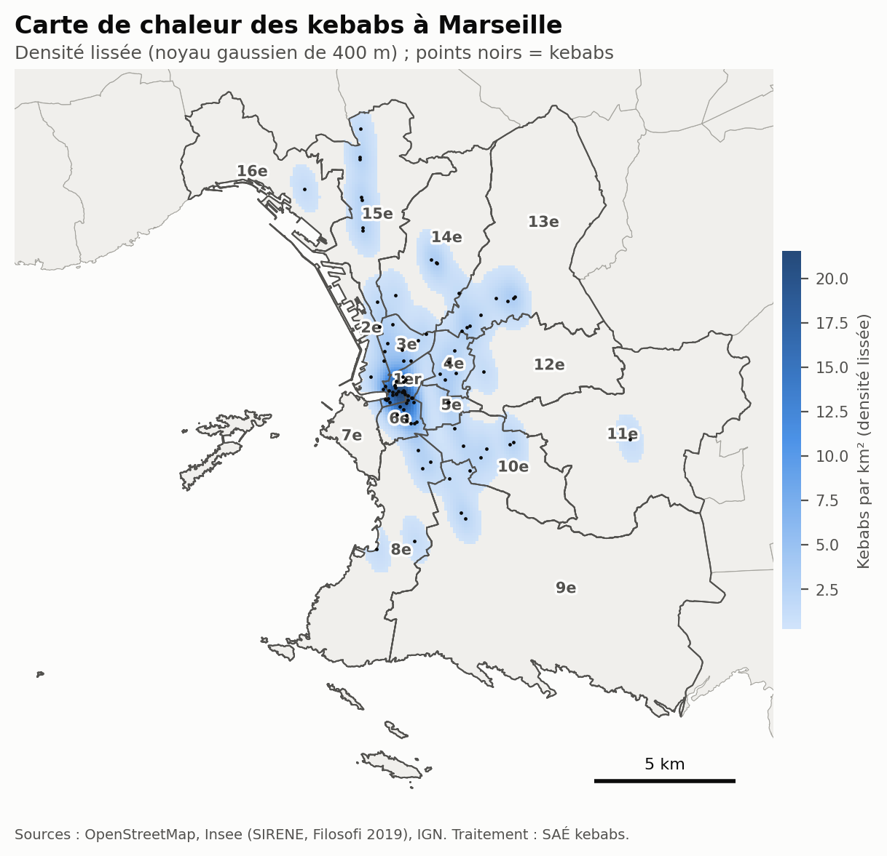

*Figure 5 : densité lissée des kebabs à Marseille.*

La carte de chaleur lisse la position des kebabs sur environ 400 mètres, soit quelques
minutes de marche. Elle fait ressortir un pôle unique et très marqué dans l'hypercentre, avec
plus de 20 kebabs au km², et quelques pôles secondaires plus modestes, à Saint-Just et
Malpassé au nord-est, et vers la Timone et Baille au sud-est.

## 4.3 Rapporter à la population

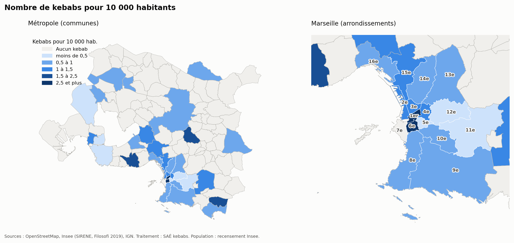

*Figure 6 : nombre de kebabs pour 10 000 habitants, par commune et par arrondissement.*

Même rapporté au nombre d'habitants (détail par arrondissement en annexe E), l'écart reste fort. Marseille compte 1,1 kebab pour
10 000 habitants, soit deux fois plus que le reste de la métropole. Les 1er et 6e
arrondissements réunissent à eux seuls 39 % des kebabs marseillais pour seulement 9 % des
habitants. La population qui vit sur place n'explique donc pas tout : l'hypercentre attire
aussi des gens de passage, avec ses commerces, sa gare et sa vie nocturne. Une opposition
entre le Nord et le Sud apparaît également, puisque les arrondissements du nord (13e à 16e)
comptent 0,9 kebab pour 10 000 habitants, deux fois plus que ceux du sud et de l'est (7e à
12e), à 0,45.

Ces taux doivent cependant être lus avec prudence dans les petites communes. À Ceyreste ou à
Ensuès-la-Redonne, un seul kebab pour environ 5 000 habitants suffit à donner un taux de
2 pour 10 000, qui n'a pas de réelle signification.

À ce stade, les cartes donnent déjà des pistes. Les kebabs sont très concentrés (H1), une
double opposition se dessine, entre centre et périphérie et entre Nord et Sud (H4), et le pôle
principal entoure la gare Saint-Charles (H3). Mais une carte peut tromper l'œil : la partie
suivante soumet ces impressions à des tests.

# 5. Croisement avec les variables socio-démographiques

## 5.1 Jointure et indicateurs

Chaque carreau de 200 mètres porte à la fois son nombre de kebabs et les sept indicateurs
décrits plus haut (section 3.5). Nous pouvons donc comparer directement les carreaux entre eux.

Avant cela, nous avons fait un choix important. Pour les carreaux de moins de 11 ménages,
l'Insee remplace les vraies valeurs par des estimations afin de respecter le secret
statistique. C'est le cas de 62 % des carreaux, mais ils ne contiennent que 7 kebabs sur 141.
Nous les avons donc écartés, pour ne travailler que sur des données réelles. Il reste
9 790 carreaux dans la métropole, dont 2 493 à Marseille. Parmi eux, 110 contiennent au
moins un kebab, dont 74 à Marseille.

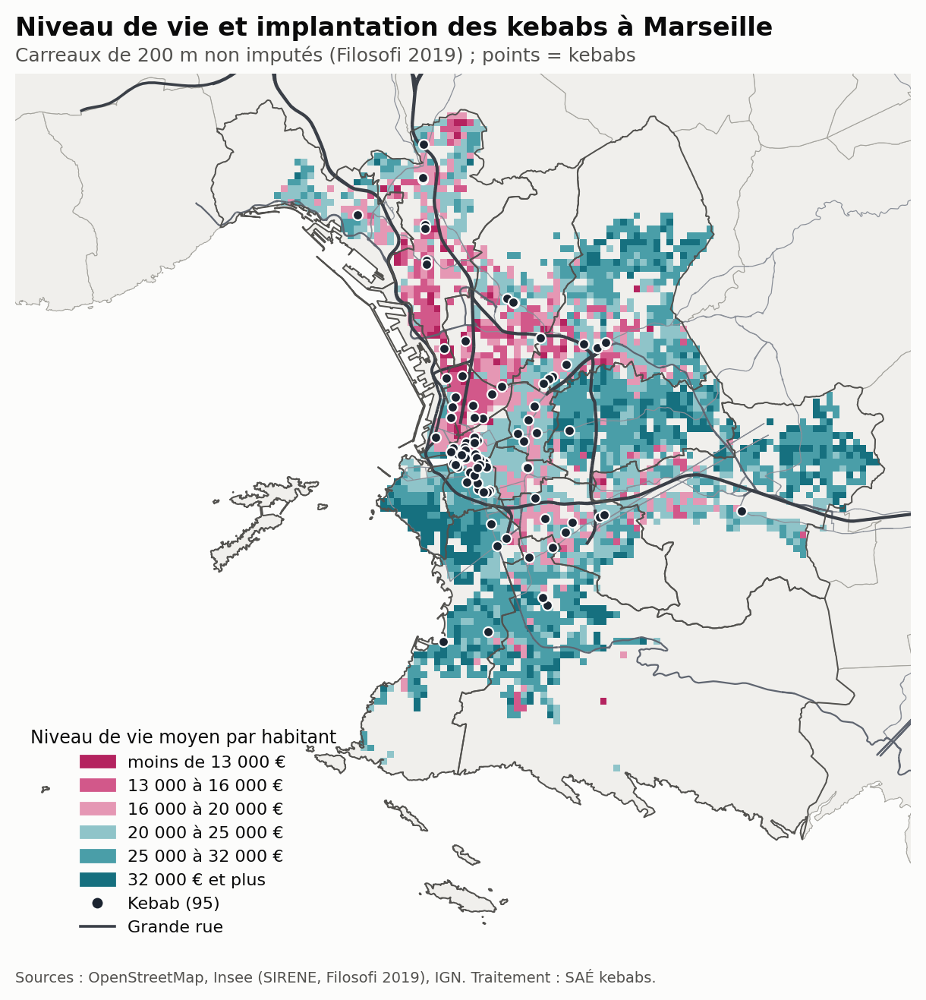

*Figure 7 : niveau de vie moyen par carreau et implantation des kebabs à Marseille.*

## 5.2 Les kebabs sont plus groupés que la population (H1)

Une objection vient tout de suite : s'il y a beaucoup de kebabs au centre, c'est peut-être
simplement parce que beaucoup de gens y habitent. Pour le vérifier, nous avons mesuré, pour chaque kebab, la distance qui le
sépare du kebab le plus proche, puis nous avons comparé la moyenne obtenue avec ce que l'on
observerait si les kebabs étaient placés au hasard là où vivent les habitants. Nous avons
simulé 999 répartitions de ce type, en tirant les carreaux en proportion de leur population.

*Tableau 3 : distance moyenne entre un kebab et le kebab le plus proche*

| Territoire | Distance observée | Distance attendue si les kebabs suivaient la population | p-valeur |
|---|---|---|---|
| Métropole | 812 m | 1 572 m | 0,001 |
| Marseille | 332 m | 575 m | 0,001 |

Les kebabs sont deux fois plus proches les uns des autres que ne le voudrait la seule
répartition des habitants. Aucune des 999 simulations n'atteint un tel regroupement, ce qui
donne une p-valeur de 0,001, la plus petite possible avec ce nombre de tirages. H1 est donc
confirmée : les kebabs se regroupent bien plus que les habitants.

## 5.3 Corrélations avec les caractéristiques des carreaux (H2)

Le nombre de kebabs par carreau est presque toujours nul et sa distribution est très
déséquilibrée. Nous utilisons donc la corrélation de Spearman, qui repose sur le classement
des valeurs et non sur les valeurs elles-mêmes, plutôt que celle de Pearson. Comme nous
réalisons 14 tests (7 indicateurs sur 2 territoires), nous appliquons la correction de Holm,
qui évite de trouver des liens significatifs par simple effet du hasard.

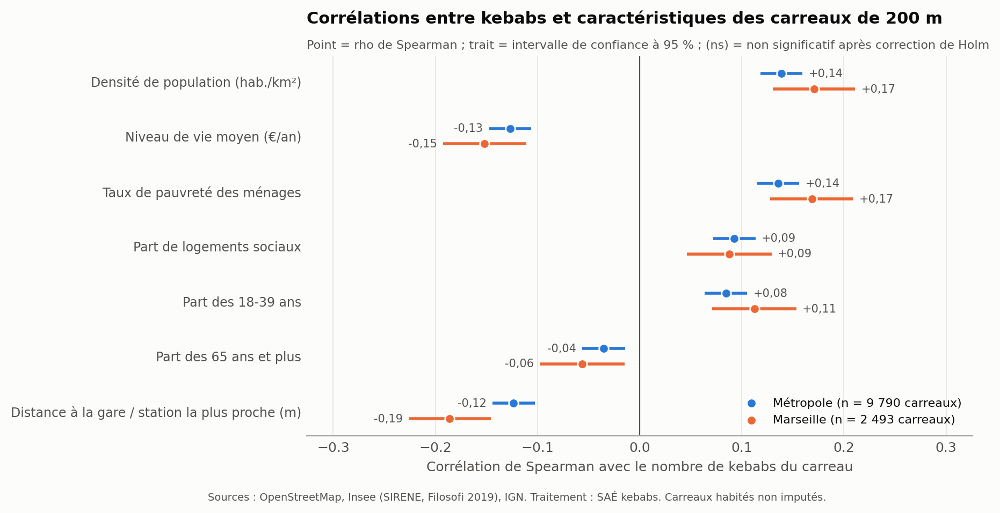

*Figure 8 : corrélations de Spearman entre le nombre de kebabs et les indicateurs des carreaux.*

Toutes les corrélations sont significatives après correction, et elles vont dans le même sens
à Marseille et dans l'ensemble de la métropole. Les kebabs sont plus nombreux dans les
carreaux denses, pauvres, jeunes et proches d'une gare ou d'une station, et plus rares dans
les carreaux aisés et âgés.

Ces corrélations restent toutefois faibles, la plus forte atteignant 0,19. Ce n'est pas
étonnant : entre 97 et 99 % des carreaux n'ont aucun kebab, ce qui réduit mécaniquement les
coefficients. La comparaison directe entre carreaux avec et sans kebab est plus parlante.
Toutes les différences présentées ci-dessous sont significatives (test de Mann-Whitney).

*Tableau 4 : valeurs médianes des carreaux avec et sans kebab, à Marseille*

| Indicateur | Carreaux avec kebab | Carreaux sans kebab |
|---|---|---|
| Densité de population | 16 600 hab./km² | 4 500 hab./km² |
| Niveau de vie moyen | 19 400 € | 24 500 € |
| Taux de pauvreté des ménages | 28 % | 13 % |
| Part des 18-39 ans | 29 % | 24 % |
| Distance à la gare ou station la plus proche | 245 m | 1 080 m |

Le logement social fait figure d'exception, avec la corrélation la plus faible. Les kebabs
s'installent bien dans des quartiers pauvres, mais pas dans les grands ensembles de logements
sociaux des quartiers Nord. On les trouve surtout dans le centre ancien, à Noailles, à
Belsunce ou le long de la Canebière, où les ménages modestes sont logés dans un parc privé
souvent dégradé.

Reste un piège. Densité, pauvreté et proximité des gares augmentent toutes à mesure que l'on
se rapproche du centre-ville. Ces indicateurs sont donc liés entre eux,
et chaque corrélation reflète en partie la même opposition entre centre et périphérie. Pour
isoler l'effet propre de chacun, nous avons calculé à Marseille des corrélations partielles,
c'est-à-dire à distance égale du Vieux-Port. Elles diminuent nettement mais restent
significatives pour le niveau de vie (-0,12), la pauvreté (0,12), la proximité des gares
(-0,11) et la densité (0,09). En revanche, le lien avec le logement social disparaît presque
(0,04). H2 tient donc pour la pauvreté, la densité et l'âge, mais pas pour
le logement social. Reste à peser chaque facteur, ce que fera le modèle (partie 6).

## 5.4 L'âge des habitants, les 25-39 ans plutôt que les étudiants

L'indicateur « part des 18-39 ans » mélange deux publics bien différents : les étudiants, qui
ont pour la plupart entre 18 et 24 ans, et les jeunes actifs, entre 25 et 39 ans. Pour savoir
lequel des deux compte, nous avons repris l'analyse avec les dix tranches d'âge de l'Insee.
Pour chacune, nous comparons sa part dans la population des carreaux avec et sans kebab, et
nous calculons sa corrélation avec le nombre de kebabs, toujours avec la correction de Holm.

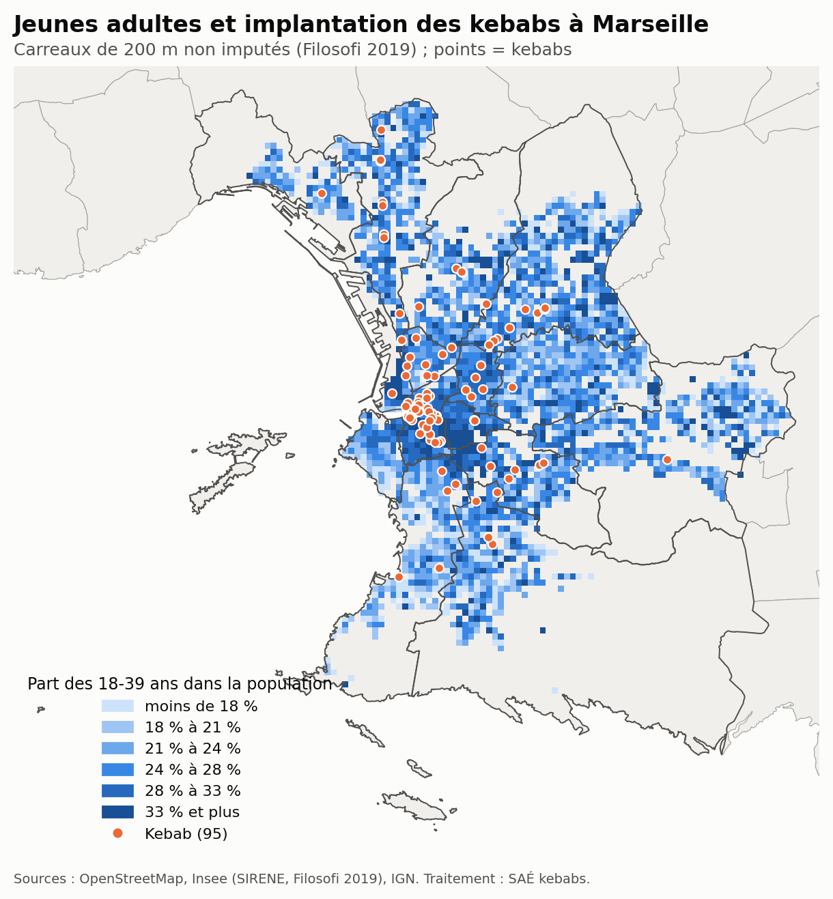

*Figure 9 : part des 18-39 ans par carreau et implantation des kebabs à Marseille.*

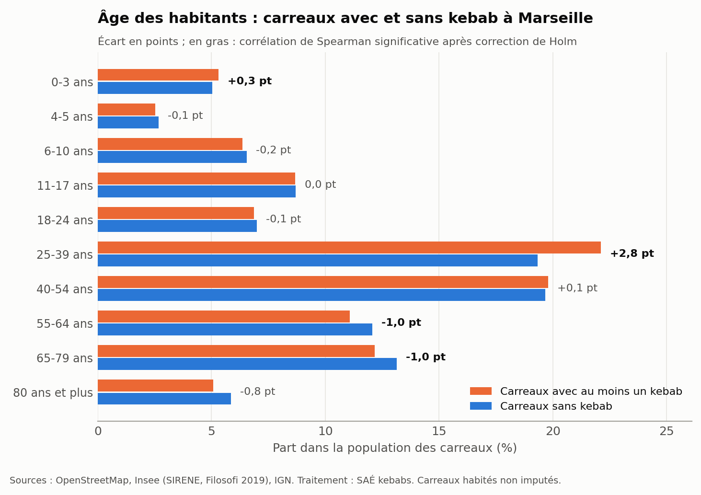

*Figure 10 : âge des habitants des carreaux avec et sans kebab, à Marseille.*

Le résultat est net : seule la tranche des 25-39 ans est plus présente autour des kebabs. Elle
représente 22,1 % des habitants des carreaux avec kebab, contre 19,3 % ailleurs, soit un
écart de 2,8 points à Marseille et de 4,1 points dans la métropole. Les 18-24 ans, eux, ne font
aucune différence (6,9 % contre 7,0 %). Les 55-79 ans sont légèrement moins présents, d'environ
un point par tranche. On note enfin un peu plus de très jeunes enfants (0-3 ans), ce qui
correspond aux enfants de ces jeunes ménages.

Contrairement à une idée répandue, le kebab n'est donc pas, à Marseille, un commerce
d'étudiants. Il s'implante plutôt là où vivent de jeunes actifs, souvent dans les petits
logements du centre ancien. Deux précautions, cependant. Les étudiants sont parfois
recensés chez leurs parents, ce qui peut les sous-estimer dans les quartiers du centre. Et
l'âge reste étroitement lié à la densité et à la pauvreté, un effet que la modélisation devra
démêler.

## 5.5 Fractures Nord-Sud et centre-périphérie à Marseille (H4)

Pour tester ces fractures, nous comparons le nombre de kebabs par habitant entre groupes
d'arrondissements à l'aide d'un test binomial exact. L'idée est simple : si les kebabs
suivaient la population, chaque groupe d'arrondissements aurait une part des kebabs égale à
sa part des habitants.

*Tableau 5 : kebabs pour 10 000 habitants selon les groupes d'arrondissements*

| Comparaison | Kebabs pour 10 000 hab. | p-valeur |
|---|---|---|
| Nord (13e-16e) et Sud-Est (7e-12e) | 0,92 contre 0,45 | 0,024 |
| Centre (1er-6e) et Nord (13e-16e) | 2,17 contre 0,92 | < 0,001 |

Les deux écarts sont significatifs. Les quartiers Nord comptent deux fois plus de kebabs par
habitant que le Sud et l'Est, et le centre en compte plus de deux fois plus que le Nord. H4 se
vérifie : la carte des kebabs suit le gradient social de Marseille, avec un centre populaire
et des quartiers Nord plus pauvres que le Sud aisé. C'est une association, pas une relation
de cause à effet.

## 5.6 Effet des gares et carte isochrone (H3)

Où sont les gares par rapport aux kebabs ? La figure 11 superpose les kebabs marseillais et
les 132 gares et stations du périmètre : gares SNCF et TER, stations de métro et arrêts de
tramway. Les kebabs suivent nettement les lignes de transport, en particulier le métro et le
tram du centre-ville, alors que les gares SNCF des quartiers périphériques n'en attirent que
peu.

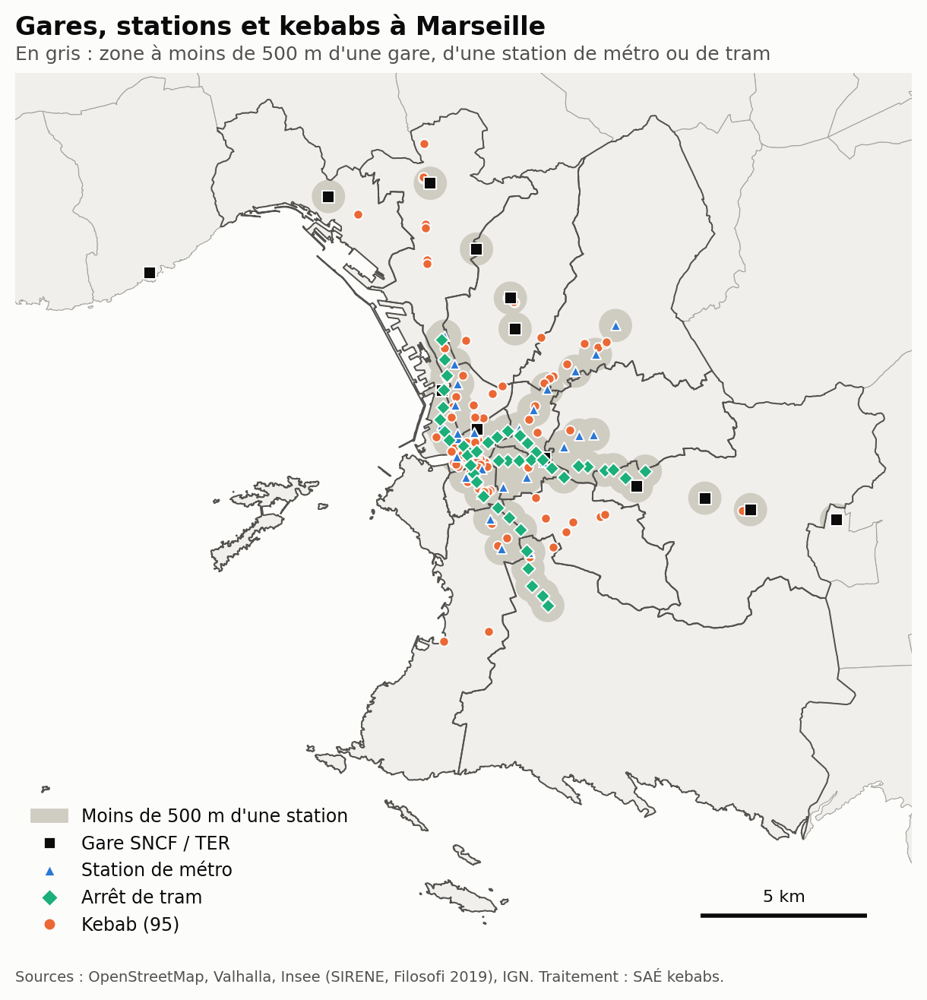

*Figure 11 : gares, stations de métro, arrêts de tram et kebabs à Marseille.*

Pour le vérifier, nous mesurons la distance de chaque kebab à la gare ou à la station la
plus proche, et nous la comparons à celle qu'auraient des kebabs placés au hasard chez les
habitants (999 simulations, comme pour le test de la section 5.2). Nous testons deux
définitions de la gare, car c'est un choix qui peut changer le résultat : les gares SNCF
seules, puis toutes les stations.

*Tableau 6 : distance des kebabs et des habitants à la gare la plus proche, à Marseille*

| Définition de la gare | Distance médiane des kebabs | Si les kebabs suivaient la population | p-valeur | Kebabs à moins de 500 m | Habitants à moins de 500 m |
|---|---|---|---|---|---|
| Gares SNCF et TER | 1 170 m | 1 630 m | 0,003 | 15 % | 8 % |
| Toutes les stations | 230 m | 700 m | 0,001 | 78 % | 39 % |

Les kebabs sont nettement plus proches des gares que les habitants, et l'écart est encore
plus fort avec les stations de métro et de tram. À Marseille, 78 % des kebabs se trouvent
à moins de 500 mètres d'une station, contre 39 % des habitants. Le résultat est le même à
l'échelle de la métropole (60 % contre 22 %). H3 est confirmée, avec une nuance de
taille : ce qui compte, c'est le métro et le tram du quotidien, bien plus que les grandes
gares.

La carte isochrone précise ce résultat autour de la principale gare, Saint-Charles. Elle
montre les zones que l'on peut atteindre à pied en 5, 10 et 15 minutes, en suivant le
réseau réel des rues et des escaliers, et non à vol d'oiseau. Ces zones ont été calculées
avec le service libre Valhalla, qui s'appuie sur les données d'OpenStreetMap.

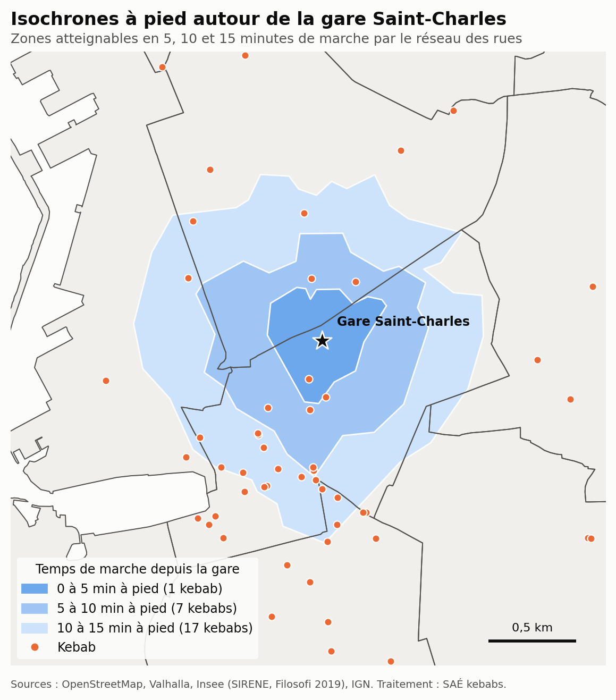

*Figure 12 : zones atteignables à pied en 5, 10 et 15 minutes depuis la gare Saint-Charles.*

*Tableau 7 : kebabs et habitants selon le temps de marche depuis la gare Saint-Charles*

| Temps de marche | Kebabs | Habitants | Kebabs pour 10 000 hab. |
|---|---|---|---|
| Moins de 5 min | 1 | 2 300 | 4,4 |
| 5 à 10 min | 7 | 18 000 | 3,9 |
| 10 à 15 min | 17 | 38 000 | 4,5 |
| Reste de Marseille | 70 | 752 000 | 0,9 |

Un quart des kebabs marseillais (25 sur 95) se trouvent à moins de 15 minutes à pied de la
gare, alors que cette zone n'abrite que 7 % des habitants de la ville. Rapporté à la
population, on y compte près de cinq fois plus de kebabs qu'ailleurs. Il y a cependant une
nuance : un seul kebab se trouve à moins de 5 minutes de la gare. Saint-Charles est perchée
sur une butte, entourée de voies ferrées et de bâtiments universitaires. Les kebabs se
concentrent plutôt entre 10 et 15 minutes de marche, en descendant vers Noailles, Belsunce
et la Canebière. Ce n'est pas le quai qui attire les kebabs, c'est le quartier
commerçant qui s'étend en contrebas. La scène 3D (section 6.4) rejoue cette marche minute
par minute.

## 5.7 Le dicton de la gare (H5)

Le dicton « plus c'est près de la gare, moins le kebab est bon » ne peut pas être testé avec
nos données, car nous ne disposons d'aucune mesure de la qualité des kebabs. OpenStreetMap et
SIRENE ne contiennent pas de notes. Les notes Google, utilisées par ceux qui ont tenté de
tester ce dicton, ne sont accessibles que par une API payante, et leur collecte automatique
est encadrée par les conditions d'utilisation du service. Un programmeur l'a fait à Paris en
2025 (Pae, 2025) : sur 400 kebabs, la corrélation entre la note Google et la distance à la
gare la plus proche n'est que de 0,09, et elle tombe à 0,001 sans les stations de métro.
L'auteur conclut lui-même que le lien est trop faible pour confirmer le dicton.

Si ces notes étaient disponibles, le protocole serait le suivant. Pour chaque kebab, on
relèverait la note moyenne et le nombre d'avis. On mesurerait la distance à pied à la gare
la plus proche, plutôt que la distance à vol d'oiseau. On relierait ensuite la note à cette
distance, en tenant compte du nombre d'avis, car un kebab qui n'a que trois avis peut avoir
une note extrême par hasard. Il faudrait aussi tester un effet de seuil : la qualité pourrait
baisser seulement dans les toutes premières centaines de mètres autour de la gare.

Nos résultats éclairent tout de même le débat. Si les kebabs se pressent près des stations,
c'est pour leur clientèle de passage, et un client de passage revient rarement : en théorie,
le commerçant a moins de raisons de soigner sa cuisine. C'est peut-être de là que vient le
dicton. Mais sans mesure de la qualité, cela reste une intuition.

# 6. Modélisation

Les kebabs se trouvent donc dans des quartiers denses, modestes, jeunes et bien desservis. Le
problème, c'est que tout cela va ensemble : à Marseille, un quartier dense est souvent pauvre
et proche du métro. Alors, qu'est-ce qui compte vraiment ? La jeunesse des habitants, leur
revenu, la station au coin de la rue ? Pour démêler ces effets, il faut un modèle qui mesure
chacun d'eux, les autres étant fixés.

## 6.1 Le modèle

Nous avons choisi une régression logistique, d'abord parce qu'elle se lit facilement ; la
section 6.3 montre qu'elle est aussi la plus performante. Pour chaque carreau de 200 mètres, elle estime la
probabilité qu'il contienne au moins un kebab, en fonction de sept caractéristiques : la
densité de population, le niveau de vie moyen, la part de logements sociaux, la part des
25-39 ans, la part des 65 ans et plus, la distance à la station la plus proche, et le fait
que le carreau soit situé à Marseille ou non. Le taux de pauvreté n'est pas retenu, car il
est presque l'inverse du niveau de vie et les deux ensemble rendraient les effets difficiles
à lire. Nous avons vérifié que les autres variables ne sont pas trop liées entre elles.

Le modèle porte sur les 9 790 carreaux de la métropole dont les données sont réelles, dont
110 contiennent un kebab. Pour comparer les effets entre eux, chaque variable est exprimée en
écarts-types : l'effet indiqué est celui d'une hausse « typique » de la variable. Il se lit
comme un multiplicateur des chances d'avoir un kebab : 2 signifie des chances doublées,
0,5 des chances divisées par deux.

## 6.2 Ce qui explique la présence d'un kebab

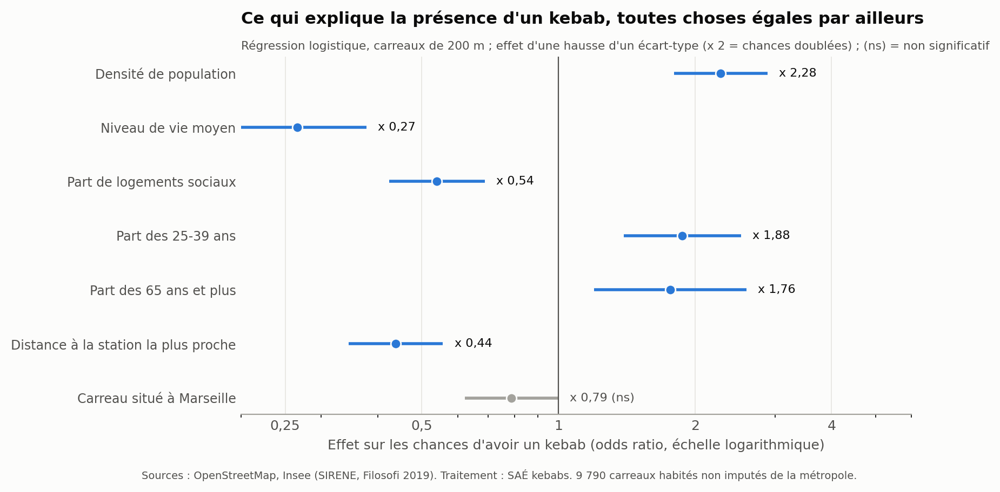

*Figure 13 : effet de chaque caractéristique sur les chances d'avoir un kebab, toutes choses
égales par ailleurs.*

*Tableau 8 : effets estimés par le modèle*

| Caractéristique du carreau | Hausse d'un écart-type | Effet sur les chances d'avoir un kebab |
|---|---|---|
| Niveau de vie moyen | + 5 500 € par an | divisées par près de 4 (x 0,27) |
| Densité de population | x 2,5 habitants | multipliées par 2,3 |
| Distance à la station la plus proche | x 2,7 en distance | divisées par 2,3 (x 0,44) |
| Part des 25-39 ans | + 7,5 points | multipliées par 1,9 |
| Part des 65 ans et plus | + 11 points | multipliées par 1,8 |
| Part de logements sociaux | + 23 points | divisées par 1,9 (x 0,54) |
| Carreau situé à Marseille | | non significatif (x 0,79) |

La réponse est claire, et elle nous a un peu surpris : le facteur le plus fort n'est ni la
densité ni la gare, c'est le niveau de vie. À densité, âge et desserte égaux, les kebabs
évitent les quartiers aisés.
Une hausse de 5 500 euros du niveau de vie moyen divise par près de quatre les chances de trouver un
kebab. Viennent ensuite la densité de population et la proximité d'une station, qui
traduisent le besoin d'une clientèle nombreuse et de passage. Les jeunes adultes comptent
aussi, mais moins : une part plus forte de 25-39 ans multiplie les chances par 1,9.

Deux résultats nous ont d'abord étonnés. À revenu égal, le logement social réduit les
chances d'avoir un kebab. Ce n'est pas contradictoire avec le reste : les kebabs s'installent
dans les quartiers modestes du centre ancien, où l'on se loge dans le parc privé, et non dans
les grands ensembles, souvent conçus sans rez-de-chaussée commerçants. L'effet positif des
65 ans et plus surprend davantage. Il faut le lire avec la part des 25-39 ans : à part de
jeunes adultes égale, plus de seniors signifie surtout moins de familles avec enfants. Ce
sont donc les quartiers familiaux et pavillonnaires qui attirent le moins les kebabs.

Enfin, une fois ces facteurs pris en compte, le fait d'être à Marseille n'a plus d'effet
propre. Les nombreux kebabs de Marseille s'expliquent donc par ses caractéristiques (densité,
pauvreté, réseau de métro et de tram), et non par un effet propre à la ville. Ces résultats
restent les mêmes lorsque l'on ne garde que les kebabs certains, ce qui montre qu'ils ne
dépendent pas de notre classement des kebabs probables.

Prudence cependant : le modèle mesure des associations, pas des causes : un
kebab ne s'installe pas parce que les habitants sont pauvres, mais peut-être parce que les
loyers commerciaux y sont plus bas, ou parce que la clientèle de passage y est nombreuse. De
plus, le modèle ne tient pas compte du fait que des carreaux voisins se ressemblent (on parle
d'autocorrélation spatiale), ce qui peut rendre les intervalles de confiance un peu trop
étroits.

## 6.3 Qualité du modèle

Pour juger le modèle, nous le testons sur des carreaux qu'il n'a pas vus pendant son
apprentissage : c'est la validation croisée. Les carreaux sont répartis en cinq groupes ; le
modèle apprend sur quatre et prédit le cinquième, et l'opération est répétée 10 fois.

*Tableau 9 : performances du modèle en validation croisée*

| Modèle | AUC | F1-score | Précision | Rappel |
|---|---|---|---|---|
| Modèle complet | 0,93 | 0,22 | 18 % | 31 % |
| Densité de population seule | 0,88 | 0,13 | 8 % | 29 % |

L'AUC mesure la capacité du modèle à classer les carreaux : elle vaut 0,5 pour un modèle qui
tirerait au hasard et 1 pour un modèle parfait. Avec 0,93, notre modèle distingue très bien
les carreaux qui ont un kebab de ceux qui n'en ont pas. Il fait nettement mieux que la seule
densité de population (0,88), ce qui confirme que le revenu, l'âge et les stations apportent
une information réelle.

Le F1-score, en revanche, est faible (0,22). Sur une validation, le modèle signale en moyenne
188 carreaux comme « à kebab » : 34 en ont réellement un, et 154 n'en ont pas. Il retrouve
ainsi 34 des 109 carreaux qui ont un kebab. Ce résultat modeste s'explique d'abord par la
rareté des kebabs : à peine plus d'un carreau sur cent en contient un, ce qui rend toute
prédiction exacte très difficile. Ensuite, beaucoup de « fausses alertes » sont sans doute de
vrais emplacements de kebabs absents de notre base, qui n'en couvre qu'environ un tiers
(section 3.3). Le modèle est donc bon pour repérer les quartiers favorables aux kebabs, mais
il ne permet pas de dire dans quelle rue précise un kebab s'installera.

Pourquoi ne pas avoir pris un modèle plus puissant ? Nous avons essayé. Avec exactement le
même protocole, une forêt aléatoire obtient une AUC de 0,916 et un gradient boosting 0,914,
contre 0,932 pour la régression logistique. Avec sept variables et seulement 110 carreaux à
kebab, les modèles plus souples manquent d'exemples pour trouver des interactions utiles, et
ils finissent par apprendre du bruit. Nous gardons donc le modèle le plus simple, qui est
aussi le seul dont on peut lire chaque effet.

Il est enfin instructif de regarder où il se trompe. Sur des carreaux qu'il n'a pas vus,
91 % des kebabs tombent dans les 20 % de carreaux qu'il juge les plus probables. Les autres
sont ses vrais ratés : un kebab à Ensuès-la-Redonne, deux à La Ciotat, deux dans le sud du
8e arrondissement, loin du métro, un dans la zone commerciale de Vitrolles. Ces ratés ne
tombent pas au hasard. Plusieurs sont en bord de mer ou en zone d'activité, où la clientèle
vient d'ailleurs, touristes ou acheteurs, alors que nos données ne décrivent que les
habitants. C'est la principale limite du modèle, et une piste d'amélioration (section 7.2).

## 6.4 Explorer les résultats en 3D

Pour rendre ces résultats lisibles par tous, nous avons réuni toutes les couches de l'étude
dans une scène 3D interactive, consultable dans un navigateur :
[coulibaly-abou.github.io/sae-kebabs-marseille/dashboard/kebabs_3d.html](https://coulibaly-abou.github.io/sae-kebabs-marseille/dashboard/kebabs_3d.html). Chaque carreau de 200 m y devient une colonne dont la
hauteur donne le nombre d'habitants et la couleur leur niveau de vie ; les kebabs sont des
colonnes dorées que l'on peut survoler. Une visite guidée en huit étapes reprend nos
hypothèses, de la fracture Nord-Sud jusqu'au modèle. L'une d'elles anime l'isochrone :
57 piétons sortent ensemble de la gare Saint-Charles et marchent vers les kebabs voisins par
les vraies rues (itinéraires Valhalla), pendant que les rames du métro et du tram roulent
sur leurs tracés réels ; un compteur égrène les minutes et les terrasses de 5, 10 et
15 minutes s'allument au passage. Une autre étape est une simulation : les 144 kebabs
quittent leur adresse pour se poser au hasard, comme la population, puis reviennent à leur
place. Le résultat des tests des sections 5.2 et 5.6 devient alors visible. Sur 1 000 tirages, la distance médiane entre un kebab et une station va de 960 à
1 870 m, alors qu'elle n'est que de 327 m pour les vrais kebabs. Le relief peut
enfin afficher la probabilité calculée par le modèle, avec les douze carreaux les plus
favorables où nous ne connaissons aucun kebab, et les ratés du modèle. L'annexe D présente
cette scène.

# 7. Retour et recommandations

## 7.1 Difficultés rencontrées

La première difficulté a été de trouver les kebabs eux-mêmes. Aucune base publique ne les
recense, et le code d'activité de l'Insee (56.10C, restauration rapide) mélange kebabs,
pizzerias, burgers et boulangeries. Nous avons donc croisé deux sources imparfaites, ce qui
a demandé un long travail de nettoyage : faux positifs à écarter un par un, anciens
exploitants restés actifs dans SIRENE au même local, règles d'appariement entre les deux
sources. Malgré cela, la méthode de capture-recapture suggère que notre base ne couvre
qu'environ un tiers des kebabs réels.

La deuxième difficulté tient aux données de l'Insee. Les carreaux de 200 m sont précieux,
mais 62 % d'entre eux contiennent des valeurs estimées pour respecter le secret statistique.
Nous avons dû les écarter, ce qui fait perdre une partie des zones peu peuplées. Ces
données datent en outre de 2019, alors que nos kebabs sont recensés en 2026.

La troisième difficulté est statistique. Moins de 2 % des carreaux contiennent un kebab :
les corrélations sont donc mécaniquement faibles, et un modèle peut paraître excellent en
répondant « pas de kebab » partout. Il a fallu choisir des indicateurs adaptés (AUC, F1,
seuil optimisé) et des tests par simulation plutôt que des tests classiques.

Enfin, des difficultés plus pratiques : les serveurs d'OpenStreetMap saturent souvent, ce qui
nous a conduits à prévoir plusieurs serveurs de secours et à mettre les réponses en cache ;
et le choix de ce qu'est une « gare » (SNCF seule ou toutes les stations) change fortement
les résultats, ce qui nous a obligés à tester les deux définitions.

## 7.2 Pistes d'amélioration

Plusieurs améliorations n'ont pas pu être réalisées, faute de temps ou de données.

- **Compléter la base des kebabs.** Un relevé sur le terrain dans quelques quartiers tests,
  ou l'usage d'une source commerciale, permettrait de mesurer précisément ce qui manque à
  OpenStreetMap et à SIRENE, et de vérifier les douze emplacements « favorables » repérés
  par le modèle.
- **Tester vraiment le dicton de la gare (H5).** Le protocole est prêt (section 5.7) : il
  suffirait des notes et du nombre d'avis de chaque kebab.
- **Décrire la clientèle de passage.** Les ratés du modèle sont en bord de mer ou en zone
  commerciale. Des données sur le tourisme (hébergements, plages) ou sur les zones d'activité
  (base permanente des équipements de l'Insee) lui donneraient ce qui lui manque.
- **Mesurer la fréquentation.** Nos résultats montrent l'importance des lieux de passage,
  mais nous l'approchons seulement par la distance aux stations. Les comptages de
  validations du métro et du tram, s'ils étaient publiés, mesureraient directement ce flux.
- **Tenir compte de l'autocorrélation spatiale.** Des carreaux voisins se ressemblent. Un
  modèle spatial, ou une validation croisée par blocs géographiques, donnerait des
  intervalles de confiance plus justes.
- **Suivre l'évolution dans le temps.** SIRENE donne la date de création de chaque
  établissement : on pourrait voir si les kebabs suivent l'ouverture des nouvelles lignes
  de tram, ou la transformation de certains quartiers.
- **Comparer avec d'autres villes.** Toute la collecte est automatisée : il suffit de
  changer le code du territoire dans la configuration pour refaire l'étude à Lyon,
  Toulouse ou Lille, et voir si le « modèle marseillais » se retrouve ailleurs.

# 8. Conclusion

Nous voulions comprendre la répartition des kebabs dans l'agglomération marseillaise, et
savoir si elle révèle d'autres fractures du territoire. La réponse est oui, sur les deux
plans.

Les kebabs ne suivent pas simplement la population : ils sont deux fois plus regroupés
qu'elle, et 66 % d'entre eux sont à Marseille, qui n'abrite que 46 % des habitants de la
métropole (H1). Ils s'installent là où se combinent une forte densité, un niveau de vie
modeste, de jeunes actifs et un passage important, près du métro et du tram (H2 et H3). Le
modèle, qui distingue très bien les carreaux à kebab des autres et bat deux méthodes plus
complexes, montre que le niveau de vie est le facteur le plus fort, et qu'une fois ces caractéristiques prises en compte, Marseille
n'a plus rien de particulier. Deux idées reçues tombent en chemin : le kebab n'est pas un
commerce d'étudiants, puisque ce sont les 25-39 ans qui comptent, et il ne s'installe pas dans
les grands ensembles de logements sociaux, mais dans le centre ancien.

La carte des kebabs est ainsi un portrait de la géographie sociale de Marseille : un
hypercentre populaire et très fréquenté, des quartiers Nord intermédiaires, et un Sud aisé
presque sans kebab (H4). Comme Pearce et ses coauteurs l'avaient montré pour la
Nouvelle-Zélande, l'association avec la pauvreté est forte, mais elle ne dit rien des causes :
loyers commerciaux plus bas, clientèle de passage ou habitudes de consommation peuvent tous
y contribuer. Quant au dicton de la gare (H5), nos données ne permettent pas de le trancher.

Ce travail ouvre une piste plus large. Le kebab n'est qu'un exemple : la même méthode,
entièrement automatisée et reproductible, pourrait suivre d'autres commerces (boulangeries,
salles de sport, cafés de spécialité) et en faire des indicateurs du changement des
quartiers. Si l'arrivée de cafés de spécialité accompagne l'embourgeoisement d'un quartier,
le recul de ses kebabs pourrait en être un signe tout aussi parlant.

# Bibliographie et sources

Les Échos, *Ce que la carte des kebabs révèle de Paris*, vidéo.

Insee, *Revenus, pauvreté et niveau de vie en 2019 : données carroyées (Filosofi)*.

OpenStreetMap et ses contributeurs, données extraites avec l'API Overpass.

Insee et DINUM, *API Recherche d'entreprises* (répertoire SIRENE).

IGN et Insee, *API Découpage administratif* (geo.api.gouv.fr).

Pearce, J., Blakely, T., Witten, K. et Bartie, P. (2007). Neighborhood Deprivation and Access
to Fast-Food Retailing: A National Study. *American Journal of Preventive Medicine*, 32(5),
375-382. https://doi.org/10.1016/j.amepre.2007.01.009

Macintyre, S., McKay, L., Cummins, S. et Burns, C. (2005). Out-of-home food outlets and area
deprivation: case study in Glasgow, UK. *International Journal of Behavioral Nutrition and
Physical Activity*, 2, 16.

Pae, J. (2025). Analyse des notes Google des kebabs parisiens selon la distance à la gare,
billet de blog (jmspae.se), repris par Gigazine, « Testing the theory that 'the closer to the
station the worse the food tastes' at a kebab shop », 26 février 2025.

Valhalla, moteur de calcul d'itinéraires libre (isochrones), service public de
FOSSGIS e.V. sur les données OpenStreetMap.

Code et données du projet : https://github.com/coulibaly-abou/sae-kebabs-marseille

Scène 3D interactive : https://coulibaly-abou.github.io/sae-kebabs-marseille/dashboard/kebabs_3d.html



# Annexes

## A. Diagramme de Gantt prévisionnel

Le diagramme ci-dessous découpe les 30 heures de la SAÉ en sept étapes, semaine par semaine,
du 21 septembre au 11 décembre 2026. La couleur indique la nature du travail.

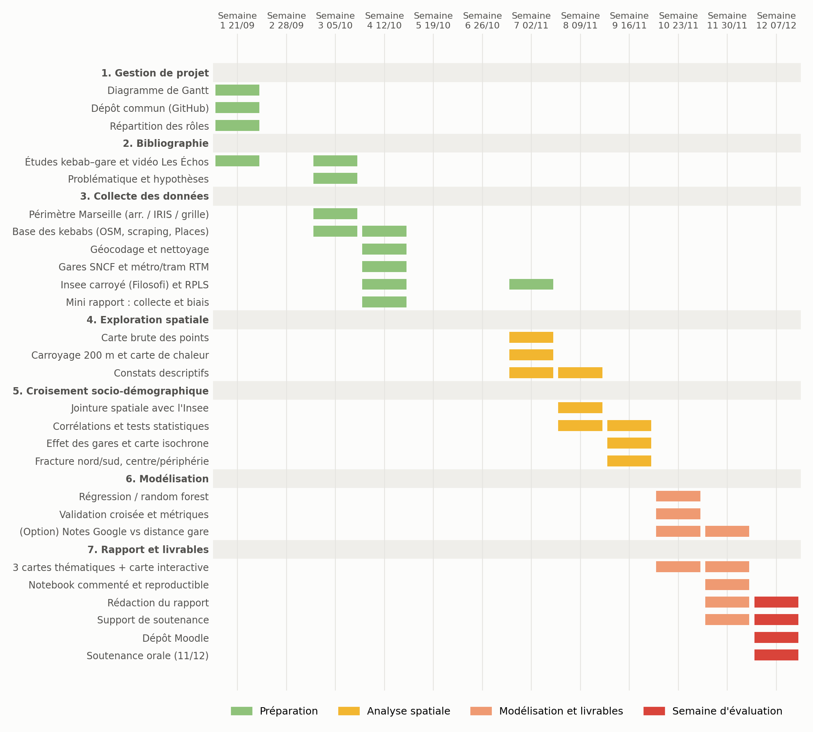

*Figure 14 : diagramme de Gantt prévisionnel du projet (30 heures, par tranches de 2 heures).*

## B. Code source

L'ensemble du traitement est réalisé en Python. Les scripts, commentés et reproductibles, se
trouvent dans le dossier scripts du projet et s'exécutent dans l'ordre de leur numéro. Ils
sont publiés sur GitHub : [github.com/coulibaly-abou/sae-kebabs-marseille](https://github.com/coulibaly-abou/sae-kebabs-marseille).

| Script | Rôle |
|---|---|
| [00_lancer_collecte.py](https://github.com/coulibaly-abou/sae-kebabs-marseille/blob/main/scripts/00_lancer_collecte.py) | Lance toute la collecte (scripts 01 à 05) |
| [01_collecte_limites.py](https://github.com/coulibaly-abou/sae-kebabs-marseille/blob/main/scripts/01_collecte_limites.py) | Limites des communes et arrondissements, découpage en 107 zones |
| [02_collecte_kebabs_osm.py](https://github.com/coulibaly-abou/sae-kebabs-marseille/blob/main/scripts/02_collecte_kebabs_osm.py) | Kebabs d'OpenStreetMap |
| [03_collecte_kebabs_sirene.py](https://github.com/coulibaly-abou/sae-kebabs-marseille/blob/main/scripts/03_collecte_kebabs_sirene.py) | Kebabs du répertoire SIRENE |
| [04_collecte_gares.py](https://github.com/coulibaly-abou/sae-kebabs-marseille/blob/main/scripts/04_collecte_gares.py) | Gares SNCF, stations de métro et arrêts de tram |
| [05_collecte_insee_carreaux.py](https://github.com/coulibaly-abou/sae-kebabs-marseille/blob/main/scripts/05_collecte_insee_carreaux.py) | Carreaux Insee Filosofi de 200 m |
| [06_nettoyage_kebabs.py](https://github.com/coulibaly-abou/sae-kebabs-marseille/blob/main/scripts/06_nettoyage_kebabs.py) | Fiabilité, doublons, fusion des deux sources |
| [07_cartes_exploratoires.py](https://github.com/coulibaly-abou/sae-kebabs-marseille/blob/main/scripts/07_cartes_exploratoires.py) | Carroyage et cartes de la partie 4 |
| [08_croisement_insee.py](https://github.com/coulibaly-abou/sae-kebabs-marseille/blob/main/scripts/08_croisement_insee.py) | Indicateurs, tests et figures des sections 5.1 à 5.5 |
| [09_contributeurs_osm.py](https://github.com/coulibaly-abou/sae-kebabs-marseille/blob/main/scripts/09_contributeurs_osm.py) | Historique des fiches kebabs d'OpenStreetMap (section 3.6) |
| [10_gares_isochrone.py](https://github.com/coulibaly-abou/sae-kebabs-marseille/blob/main/scripts/10_gares_isochrone.py) | Distance aux gares et isochrones de Saint-Charles (section 5.6) |
| [11_modelisation.py](https://github.com/coulibaly-abou/sae-kebabs-marseille/blob/main/scripts/11_modelisation.py) | Régression logistique et validation croisée (partie 6) |
| [12_scene_3d.py](https://github.com/coulibaly-abou/sae-kebabs-marseille/blob/main/scripts/12_scene_3d.py) | Scène 3D interactive et simulation de Monte-Carlo (section 6.4, annexe D) |
| [14_collecte_mouvement.py](https://github.com/coulibaly-abou/sae-kebabs-marseille/blob/main/scripts/14_collecte_mouvement.py) | Tracés du métro et du tram, trajets à pied depuis Saint-Charles (scène animée) |
| [15_comparaison_modeles.py](https://github.com/coulibaly-abou/sae-kebabs-marseille/blob/main/scripts/15_comparaison_modeles.py) | Comparaison avec forêt aléatoire et gradient boosting, ratés du modèle (section 6.3) |
| [13_figures_rapport.py](https://github.com/coulibaly-abou/sae-kebabs-marseille/blob/main/scripts/13_figures_rapport.py) | Figure de l'article, diagramme de Gantt, captures de la scène 3D |

Deux extraits, pour donner une idée du code. Le premier ajuste le modèle de la partie 6 :
les variables sont centrées et réduites, si bien que chaque coefficient, passé à
l'exponentielle, se lit comme un multiplicateur des chances pour une hausse d'un écart-type
([11_modelisation.py](https://github.com/coulibaly-abou/sae-kebabs-marseille/blob/main/scripts/11_modelisation.py)).

```python
def ajuster(d: pd.DataFrame, cible: str) -> pd.DataFrame:
    """Régression logistique sur variables centrées-réduites : odds ratios par écart-type."""
    X = d[list(VARIABLES)]
    Z = (X - X.mean()) / X.std()
    modele = sm.Logit(d[cible], sm.add_constant(Z)).fit(disp=False)
    ic = np.exp(modele.conf_int())
    return pd.DataFrame({
        "variable": list(VARIABLES),
        "odds_ratio": np.exp(modele.params[list(VARIABLES)]).values,
        "ic_bas": ic.loc[list(VARIABLES), 0].values, "ic_haut": ic.loc[list(VARIABLES), 1].values,
        "p": modele.pvalues[list(VARIABLES)].values,
    })
```

Le second est le cœur de la simulation de Monte-Carlo (sections 5.2, 5.6 et 6.4) : on place
144 kebabs fictifs au hasard, chaque carreau ayant une chance proportionnelle à son nombre
d'habitants, puis on mesure leur distance aux stations et entre eux, 1 000 fois de suite
([12_scene_3d.py](https://github.com/coulibaly-abou/sae-kebabs-marseille/blob/main/scripts/12_scene_3d.py)).

```python
def tirage(n):
    i = rng.choice(len(d), size=n, p=poids)          # carreaux tirés selon la population
    lat = d["lat"].values[i] + rng.uniform(-100, 100, n) / 111_320
    lon = d["lon"].values[i] + rng.uniform(-100, 100, n) / (111_320 * np.cos(lat0))
    return lon, lat


def indicateurs(lon, lat):
    dist_st = arbre.query(np.radians(np.c_[lat, lon]), k=1)[0][:, 0] * R_TERRE
    pts = np.radians(np.c_[lat, lon])
    voisins = BallTree(pts, metric="haversine").query(pts, k=2)[0][:, 1] * R_TERRE
    return {"station_mediane_m": float(np.median(dist_st)),
            "part_500m_station": float(np.mean(dist_st < 500)),
            "voisin_moyen_m": float(np.mean(voisins))}


reel = indicateurs(k["lon"].values, k["lat"].values)
sims = pd.DataFrame([indicateurs(*tirage(len(k))) for _ in range(N_SIMULATIONS)])
```

## C. Dictionnaire des données

*Tableau 10 : base des kebabs, description des colonnes (fichier kebabs.csv, 144 lignes)*

| Colonne | Description |
|---|---|
| id_kebab | Identifiant du kebab dans notre base (K001 à K144) |
| nom | Nom ou enseigne |
| fiabilite | certain (mot-clé kebab dans le nom ou cuisine kebab seule) ou probable |
| source | osm, sirene, ou osm+sirene si le kebab est dans les deux sources |
| lat, lon | Coordonnées GPS (WGS84) ; position OpenStreetMap si disponible |
| code_zone, commune, arrondissement | Commune, et arrondissement pour Marseille |
| siret, osm_id | Identifiants dans SIRENE et dans OpenStreetMap |
| adresse, naf, date_creation | Adresse, code d'activité et date de création (SIRENE) |
| cuisine_osm | Cuisine déclarée dans OpenStreetMap |
| regle_appariement, distance_osm_sirene_m | Règle et distance qui ont permis de relier les deux sources |

**Indicateurs des carreaux** (fichier carreaux_indicateurs.gpkg, un carreau de 200 m par ligne).
Les variables d'origine sont celles de Filosofi 2019 : ind (individus), men (ménages),
men_pauv (ménages pauvres), ind_snv (somme des niveaux de vie), log_soc (logements sociaux),
log_av45 à log_inc (logements par période de construction), ind_0_3 à ind_80p (individus
par tranche d'âge).

*Tableau 11 : calcul des indicateurs des carreaux*

| Indicateur | Calcul |
|---|---|
| Densité de population (hab./km²) | ind / surface du carreau (0,04 km²) |
| Niveau de vie moyen (€/an) | ind_snv / ind |
| Taux de pauvreté des ménages | men_pauv / men |
| Part de logements sociaux | log_soc / (log_av45 + log_45_70 + log_70_90 + log_ap90 + log_inc) |
| Part des 18-39 ans | (ind_18_24 + ind_25_39) / ind |
| Part des 25-39 ans (modèle) | ind_25_39 / ind |
| Part des 65 ans et plus | (ind_65_79 + ind_80p) / ind |
| Distance à la gare ou station (m) | distance à vol d'oiseau, en Lambert 93, du centre du carreau à la gare, station de métro ou arrêt de tram le plus proche |
| Distance au Vieux-Port (m) | distance du centre du carreau au Vieux-Port (corrélations partielles) |
| nb_kebabs, presence_kebab | nombre de kebabs du carreau, et 1 s'il en contient au moins un |
| i_est_200 | 1 si l'Insee a remplacé les valeurs du carreau par une estimation (carreaux écartés) |

## D. Scène 3D interactive

La scène est un fichier HTML autonome (dossier dashboard du projet), produit par le script
12_scene_3d.py à partir des données traitées ; elle s'ouvre dans n'importe quel navigateur
récent et est publiée en ligne : [coulibaly-abou.github.io/sae-kebabs-marseille/dashboard/kebabs_3d.html](https://coulibaly-abou.github.io/sae-kebabs-marseille/dashboard/kebabs_3d.html).
Elle utilise la bibliothèque deck.gl. On peut la faire pivoter, zoomer, survoler chaque
kebab, carreau ou station, et activer ou masquer chaque couche.

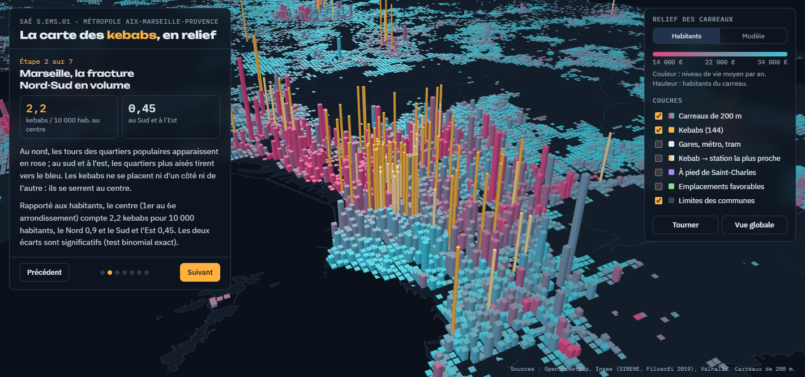

*Figure 15 : la scène 3D sur Marseille. Hauteur des colonnes : habitants du carreau ; couleur :
niveau de vie (rose pour les plus modestes, bleu pour les plus aisés) ; colonnes dorées : kebabs.*

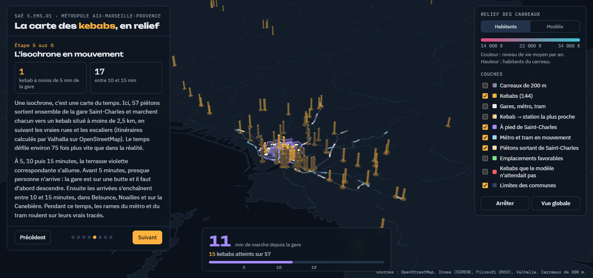

*Figure 16 : l'isochrone en mouvement, à la 11e minute. Les piétons (points clairs et leur
traînée) descendent de la gare par les vraies rues ; les kebabs déjà atteints s'allument ; les
rames du métro et du tram circulent sur leurs tracés.*

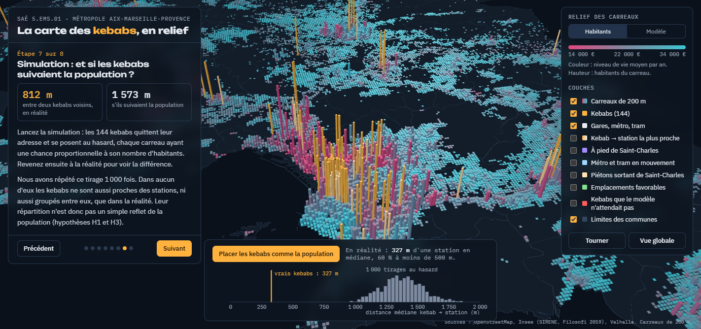

*Figure 17 : l'étape de simulation. L'histogramme montre la distance médiane entre un kebab et
une station dans 1 000 placements au hasard selon la population ; le trait doré marque les
vrais kebabs (327 m).*

## E. Kebabs par arrondissement de Marseille

*Tableau 12 : kebabs par arrondissement de Marseille*

| Arrondissement | Kebabs | Population | Kebabs pour 10 000 hab. |
|---|---|---|---|
| 1er | 23 | 37 599 | 6,1 |
| 2e | 3 | 24 378 | 1,2 |
| 3e | 8 | 58 029 | 1,4 |
| 4e | 5 | 49 363 | 1,0 |
| 5e | 2 | 45 702 | 0,4 |
| 6e | 14 | 38 476 | 3,6 |
| 7e | 0 | 35 173 | 0,0 |
| 8e | 5 | 84 683 | 0,6 |
| 9e | 4 | 77 406 | 0,5 |
| 10e | 6 | 60 317 | 1,0 |
| 11e | 1 | 59 883 | 0,2 |
| 12e | 1 | 64 399 | 0,2 |
| 13e | 8 | 95 112 | 0,8 |
| 14e | 5 | 60 505 | 0,8 |
| 15e | 9 | 79 161 | 1,1 |
| 16e | 1 | 15 854 | 0,6 |
| Marseille | 95 | 886 040 | 1,1 |
| Reste de la métropole | 49 | 1 053 037 | 0,5 |
