<!--
NOTES DE RÉDACTION (invisibles à l'affichage)
- Consignes : 15 pages max hors page de garde, sommaire et annexes ; le code va en annexe.
- Rendu final via Quarto : renommer ce fichier en .qmd, ajouter `toc: true` dans l'en-tête
  et remplacer les 
 par .
- Au moins 3 cartes thématiques + 1 carte isochrone (dossier rapport/figures/).
- Style : texte rédigé, peu de gras, pas de noms de fichiers dans le corps (annexe B).
- Repères [À FAIRE] = sections à rédiger plus tard, quand les analyses seront faites.
-->

Université de Perpignan Via Domitia 
IUT, BUT Science des Données, 3e année

   

# Étude de l'implantation des kebabs dans l'agglomération marseillaise

### Ce que la carte des kebabs révèle de la métropole Aix-Marseille-Provence

 

*SAÉ 5.EMS.01 : Mener une étude statistique dans un domaine d'application*

  

Réalisé par Coulibaly Aboubakar, [Nom 2] et [Nom 3] 
Encadrant : Sébastien Pinel 
Année universitaire 2026-2027 
Rendu le [jj/mm/2027]

## Sommaire

- [Résumé](#résumé)
- [Glossaire](#glossaire)
- [1. Introduction](#1-introduction)
  - [1.1 Contexte](#11-contexte)
  - [1.2 Problématique](#12-problématique)
  - [1.3 Hypothèses de départ](#13-hypothèses-de-départ)
- [2. Gestion de projet](#2-gestion-de-projet)
  - [2.1 Organisation du groupe](#21-organisation-du-groupe)
  - [2.2 Planning](#22-planning)
- [3. Méthodologie de collecte des données](#3-méthodologie-de-collecte-des-données)
  - [3.1 Périmètre d'étude](#31-périmètre-détude)
  - [3.2 Sources mobilisées](#32-sources-mobilisées)
  - [3.3 Constitution de la base des kebabs](#33-constitution-de-la-base-des-kebabs)
  - [3.4 Gares et stations](#34-gares-et-stations)
  - [3.5 Données socio-démographiques](#35-données-socio-démographiques)
  - [3.6 Limites et biais de la collecte](#36-limites-et-biais-de-la-collecte)
- [4. Analyse exploratoire spatiale](#4-analyse-exploratoire-spatiale)
  - [4.1 Répartition des kebabs](#41-répartition-des-kebabs)
  - [4.2 Carroyage et densité](#42-carroyage-et-densité)
  - [4.3 Rapporter à la population](#43-rapporter-à-la-population)
- [5. Croisement avec les variables socio-démographiques](#5-croisement-avec-les-variables-socio-démographiques)
  - [5.1 Jointure et indicateurs](#51-jointure-et-indicateurs)
  - [5.2 Les kebabs sont plus groupés que la population (H1)](#52-les-kebabs-sont-plus-groupés-que-la-population-h1)
  - [5.3 Corrélations avec les caractéristiques des carreaux (H2)](#53-corrélations-avec-les-caractéristiques-des-carreaux-h2)
  - [5.4 L'âge des habitants, les 25-39 ans plutôt que les étudiants](#54-lâge-des-habitants-les-25-39-ans-plutôt-que-les-étudiants)
  - [5.5 Fractures Nord-Sud et centre-périphérie à Marseille (H4)](#55-fractures-nord-sud-et-centre-périphérie-à-marseille-h4)
  - [5.6 Effet des gares et carte isochrone (H3)](#56-effet-des-gares-et-carte-isochrone-h3)
  - [5.7 Le dicton de la gare (H5)](#57-le-dicton-de-la-gare-h5)
- [6. Modélisation](#6-modélisation)
  - [6.1 Le modèle](#61-le-modèle)
  - [6.2 Ce qui explique la présence d'un kebab](#62-ce-qui-explique-la-présence-dun-kebab)
  - [6.3 Qualité du modèle](#63-qualité-du-modèle)
- [7. Retour et recommandations](#7-retour-et-recommandations)
- [8. Conclusion](#8-conclusion)
- [Bibliographie et sources](#bibliographie-et-sources)
- [Annexes](#annexes)
  - [A. Diagramme de Gantt prévisionnel](#a-diagramme-de-gantt-prévisionnel)
  - [B. Code source](#b-code-source)
  - [C. Dictionnaire des données](#c-dictionnaire-des-données)

### Liste des figures

| N° | Titre | Section |
|---|---|---|
| 1 | Les kebabs de la métropole | 4.1 |
| 2 | Les kebabs à Marseille, zoom sur l'hypercentre | 4.1 |
| 3 | Nombre de kebabs par carreau de 200 m | 4.2 |
| 4 | Carte de chaleur des kebabs à Marseille | 4.2 |
| 5 | Nombre de kebabs pour 10 000 habitants | 4.3 |
| 6 | Niveau de vie et implantation des kebabs à Marseille | 5.1 |
| 7 | Corrélations entre kebabs et caractéristiques des carreaux | 5.3 |
| 8 | Jeunes adultes et implantation des kebabs à Marseille | 5.4 |
| 9 | Âge des habitants des carreaux avec et sans kebab | 5.4 |
| 10 | Isochrones à pied autour de la gare Saint-Charles | 5.6 |
| 11 | Gares, stations et kebabs à Marseille | 5.6 |
| 12 | Ce qui explique la présence d'un kebab (modèle) | 6.2 |

### Liste des tableaux

| N° | Titre | Section |
|---|---|---|
| 1 | Sources de données mobilisées | 3.2 |
| 2 | Base finale des kebabs par source et fiabilité | 3.3 |
| 3 | Kebabs par arrondissement de Marseille | 4.3 |
| 4 | Test de regroupement des kebabs | 5.2 |
| 5 | Carreaux avec et sans kebab à Marseille | 5.3 |
| 6 | Taux de kebabs par groupe d'arrondissements | 5.5 |
| 7 | Kebabs et habitants selon le temps de marche depuis Saint-Charles | 5.6 |
| 8 | Distance des kebabs et des habitants aux gares | 5.6 |
| 9 | Effets estimés par le modèle | 6.2 |
| 10 | Performances du modèle en validation croisée | 6.3 |

## Résumé

[À FAIRE, à rédiger en dernier : en 5 à 8 lignes, la question posée, les données utilisées,
la méthode, les principaux résultats et la réponse à la problématique.]

Mots-clés : kebab, analyse spatiale, Marseille, Aix-Marseille-Provence, données carroyées,
Insee Filosofi, OpenStreetMap, SIRENE, gares, inégalités socio-spatiales.

## Glossaire

| Terme | Définition |
|---|---|
| Agglomération | Dans cette étude, le territoire de la Métropole d'Aix-Marseille-Provence (92 communes) |
| API | Service en ligne qu'un programme peut interroger pour récupérer des données |
| Carreau Insee | Carré de 200 m de côté pour lequel l'Insee diffuse des statistiques |
| EPCI | Établissement public de coopération intercommunale, ici la métropole |
| Filosofi | Fichier de l'Insee sur les revenus et la pauvreté, issu des données fiscales |
| Isochrone | Zone que l'on peut atteindre depuis un point en un temps donné, par exemple 10 minutes à pied |
| NAF | Nomenclature des activités françaises (56.10C correspond à la restauration rapide) |
| OSM | OpenStreetMap, carte collaborative et libre |
| SIRENE | Répertoire de l'Insee qui recense les entreprises et leurs établissements |
| SIRET | Numéro unique d'un établissement, à 14 chiffres |

# 1. Introduction

## 1.1 Contexte

Le kebab est l'un des commerces de restauration rapide les plus répandus en France. Une
vidéo des Échos, « Ce que la carte des kebabs révèle de Paris », a montré que leur
répartition dans la capitale reflète ses fractures sociales. Sur internet, un dicton fait
aussi débat : « plus c'est près de la gare, moins le kebab est bon ».

Nous avons voulu transposer cette démarche à l'agglomération marseillaise, que nous
entendons ici comme la Métropole d'Aix-Marseille-Provence. Elle réunit 92 communes, environ
1,9 million d'habitants et 3 150 km². C'est un territoire très contrasté. On y trouve une
grande ville dense et marquée par une forte opposition entre ses quartiers Nord et Sud
(Marseille, 886 000 habitants répartis en 16 arrondissements), une seconde ville plutôt aisée
(Aix-en-Provence), des pôles industriels autour de l'étang de Berre et de Fos-sur-Mer, et de
nombreuses communes périurbaines ou rurales.

## 1.2 Problématique

> Comment expliquer la répartition spatiale des kebabs dans l'agglomération marseillaise,
> et cette répartition révèle-t-elle d'autres fractures socio-spatiales du territoire ?

## 1.3 Hypothèses de départ

Pour répondre à cette question, nous partons de cinq hypothèses.

La première (H1) est que les kebabs ne sont pas répartis de façon homogène : ils se
concentreraient dans certaines zones, comme les centres-villes et les axes passants, et
davantage à Marseille que dans le reste de la métropole.

La deuxième (H2) est que leur densité dépend des caractéristiques des habitants : densité de
population, part de jeunes, niveau de revenu et part de logements sociaux.

La troisième (H3) est que les kebabs sont plus nombreux à proximité des gares et des stations.

La quatrième (H4) est que leur répartition diffère nettement entre les quartiers Nord et Sud
de Marseille, et entre le centre de la métropole et sa périphérie.

Enfin, à titre d'ouverture, la cinquième (H5) reprend le dicton : les kebabs proches d'une
gare seraient moins bien notés.

# 2. Gestion de projet

## 2.1 Organisation du groupe

| Membre | Rôle principal |
|---|---|
| Coulibaly Aboubakar | [À FAIRE] |
| [Nom 2] | [À FAIRE] |
| [Nom 3] | [À FAIRE] |

Nous travaillons sur un espace commun, un dossier Google Drive partagé qui contient les
scripts, les données et le rapport.

## 2.2 Planning

Le diagramme de Gantt prévisionnel, établi sur 30 heures par tranches de 2 heures, est
présenté en annexe A.

# 3. Méthodologie de collecte des données

Il n'existe aucune liste de kebabs prête à l'emploi en open data. Nous avons donc constitué
notre propre base en croisant plusieurs sources. Toute la collecte est automatisée en Python,
ce qui la rend entièrement reproductible (voir l'annexe B).

## 3.1 Périmètre d'étude

Notre terrain d'étude est la Métropole d'Aix-Marseille-Provence et ses 92 communes. Pour les
comparaisons entre territoires, nous découpons la ville de Marseille en ses 16 arrondissements,
plus fins que la commune. Cela donne 107 zones de travail : les 91 autres communes et les
16 arrondissements marseillais.

Pour les analyses statistiques, nous descendons à une échelle beaucoup plus fine, celle du
carreau Insee de 200 mètres de côté. La métropole compte 25 957 carreaux habités, dont 3 150
à Marseille. C'est l'échelle la plus fine que diffuse l'Insee, et celle que propose le sujet :
elle permet de distinguer une rue commerçante d'un quartier résidentiel voisin. Nous avons
aussi refait les analyses avec des carreaux de 1 km, en additionnant les petits carreaux :
les conclusions sont les mêmes, avec des corrélations plus fortes car il y a moins de
carreaux vides.

Enfin, un zoom sur la ville de Marseille permet de comparer nos résultats à l'étude
parisienne.

## 3.2 Sources mobilisées

*Tableau 1 : sources de données mobilisées*

| Donnée | Source | Usage |
|---|---|---|
| Limites des communes et arrondissements | API Découpage administratif (IGN, Insee) | Périmètre, regroupements |
| Kebabs | OpenStreetMap, via l'API Overpass | Base de travail |
| Kebabs | Répertoire SIRENE de l'Insee, via l'API Recherche d'entreprises | Base de travail |
| Gares, métro, tram | OpenStreetMap, via l'API Overpass | Calcul de distances |
| Population, revenus, âges, logement | Insee, Filosofi 2019, carreaux de 200 m | Variables explicatives |

## 3.3 Constitution de la base des kebabs

Dans OpenStreetMap, nous retenons les établissements dont la cuisine est déclarée comme
kebab, döner ou shawarma, ainsi que les fast-foods et restaurants dont le nom contient
« kebab » ou « döner ». Nous obtenons ainsi 85 établissements répartis dans 16 communes,
dont 55 à Marseille.

Dans SIRENE, nous cherchons les établissements de restauration encore en activité dont le
nom ou l'enseigne contient un mot-clé. Les mots-clés principaux (kebab, doner, döner, durum)
renvoient 51 établissements. Des mots-clés secondaires, plus incertains, comme Istanbul,
Bosphore, Antalya, Berliner ou Shawarma, en ajoutent 39. Cela fait 90 établissements dans
12 communes, dont 63 à Marseille. Nous avons aussi testé les mots « grill », « snack » et
« tacos », puis nous les avons abandonnés, car ils ramenaient trop de restaurants qui ne
sont pas des kebabs.

Ces deux listes brutes ont ensuite été nettoyées et fusionnées en quatre étapes.

Nous avons d'abord jugé la fiabilité de chaque établissement. Il est considéré comme
certain si son nom contient un mot-clé kebab ou si sa seule cuisine déclarée est le kebab.
Il est considéré comme probable si le kebab n'est qu'une offre parmi d'autres, dans un snack
généraliste par exemple, ou si son nom est seulement évocateur, comme « Istanbul ». Dix
établissements ont été écartés comme faux positifs : la recherche de SIRENE ramenait par
exemple une pizzeria (Pizza King) ou un restaurant de paella, et nous avons retiré à la main
une pâtisserie orientale.

Nous avons ensuite supprimé les doublons à l'intérieur de SIRENE. Quand un local change
d'exploitant, l'ancien établissement reste parfois enregistré comme actif. C'est le cas,
par exemple, de cinq établissements successifs au 18-20 cours Belsunce. Nous avons regroupé
les établissements situés à moins de 30 mètres l'un de l'autre et portant des noms proches,
en gardant le plus récent. Sept doublons ont ainsi été éliminés.

La troisième étape consistait à reconnaître les kebabs présents dans les deux sources. Deux
fiches désignent le même lieu si elles ont le même numéro SIRET, si elles sont à moins de
100 mètres avec des noms proches, ou si elles se trouvent à la même adresse (moins de
10 mètres). La distance seule ne suffit pas, car deux kebabs différents sont parfois voisins.
Nous avons retrouvé 14 kebabs dans les deux sources, dont la moitié grâce au SIRET.

Enfin, nous avons fusionné le tout, à raison d'une ligne par kebab. Lorsqu'un kebab est dans
les deux sources, nous gardons la position donnée par OpenStreetMap, plus précise, car elle
est placée sur le bâtiment et non déduite de l'adresse.

*Tableau 2 : base finale des kebabs selon la source et la fiabilité*

| Source | Certain | Probable | Total |
|---|---|---|---|
| OpenStreetMap seul | 40 | 30 | 70 |
| SIRENE seul | 39 | 21 | 60 |
| Les deux sources | 13 | 1 | 14 |
| Total | 92 | 52 | 144 |

Notre base finale compte 144 kebabs, dont 95 à Marseille et 13 à Aix-en-Provence. Les deux
sources n'ont que 14 kebabs en commun : elles se complètent bien, mais aucune n'est
exhaustive. Nous menons les analyses sur l'ensemble des kebabs, certains et probables, puis
nous vérifions que les résultats tiennent avec les seuls kebabs certains.

Ce faible recouvrement permet aussi d'estimer le nombre réel de kebabs par la méthode de
capture-recapture de Lincoln-Petersen :
$\hat N = \frac{n_{OSM} \times n_{SIRENE}}{n_{commun}} = \frac{84 \times 74}{14} \approx 440$.
Notre base couvrirait donc environ un tiers des kebabs de la métropole. Ce chiffre reste
indicatif, car la méthode suppose que les deux sources sont indépendantes, ce qui est
douteux : un kebab bien visible, avec « kebab » dans son nom, a plus de chances de figurer
dans les deux.

## 3.4 Gares et stations

Nous avons extrait d'OpenStreetMap 42 gares SNCF et TER, 29 stations de métro et 61 arrêts
de tramway (à Marseille et Aubagne). Nous avons aussi gardé cinq gares situées juste en dehors
de la métropole, comme Bandol ou Saint-Martin-de-Crau, car elles peuvent être la gare la plus
proche d'un kebab situé en bordure. La définition même de la « gare » est un choix de
méthode : nous testerons d'abord les gares SNCF seules, puis l'ensemble des stations de
transport en commun.

## 3.5 Données socio-démographiques

Les caractéristiques des habitants proviennent des données carroyées Filosofi 2019 de
l'Insee. Les carreaux de 200 mètres couvrant la métropole regroupent 1 822 434 habitants,
dont 810 486 à Marseille. Chaque carreau est rattaché à la commune, ou à l'arrondissement,
qui contient son centre.

À partir de ces données, nous construisons pour chaque carreau sept indicateurs : la densité
de population, le niveau de vie moyen par habitant, le taux de pauvreté des ménages, la part
de logements sociaux, la part des 18-39 ans, la part des 65 ans et plus, et la distance à la
gare ou à la station la plus proche. Le détail des calculs figure dans le dictionnaire des
données (annexe C).

## 3.6 Limites et biais de la collecte

Notre collecte comporte plusieurs limites qu'il faut garder à l'esprit.

La première concerne l'exhaustivité. OpenStreetMap est une carte collaborative, remplie par
des bénévoles : n'importe qui peut y ajouter ou corriger un restaurant. Pour savoir qui
renseigne nos kebabs, nous avons récupéré l'historique de leurs fiches. Les 85 kebabs ont
été modifiés en dernier par 53 contributeurs différents, mais un seul d'entre eux a mis à
jour 16 fiches, et les trois plus actifs en couvrent près d'un tiers. La source dépend donc
beaucoup de quelques passionnés, souvent plus actifs dans les grandes villes qu'à la campagne.
Les fiches sont en revanche plutôt récentes : 78 % ont été modifiées depuis 2024, même si un
quart n'ont jamais été retouchées depuis leur création, et deux datent de 2012.

SIRENE, de son côté, ne permet de trouver que les kebabs dont le nom contient un mot-clé :
un « Snack du Port » qui vend des kebabs reste invisible.

À l'inverse, la recherche dans SIRENE ramène des restaurants qui ne sont pas des kebabs. Nous
en avons écarté dix, mais les établissements classés comme probables restent incertains.

Les données n'ont pas non plus la même date. OpenStreetMap et SIRENE sont à jour en 2026,
alors que les données Filosofi datent de 2019. Par ailleurs, SIRENE indique si un
établissement est fermé, mais OpenStreetMap ne le fait pas toujours.

Il faut aussi tenir compte du secret statistique : pour les carreaux très peu peuplés,
l'Insee remplace les vraies valeurs par des estimations.

Enfin, une grande partie de la métropole est rurale ou naturelle. La plupart des carreaux
n'ont donc aucun kebab, ce dont les modèles devront tenir compte.

# 4. Analyse exploratoire spatiale

Toutes les cartes de cette partie sont construites à partir de la base nettoyée de
144 kebabs.

## 4.1 Répartition des kebabs

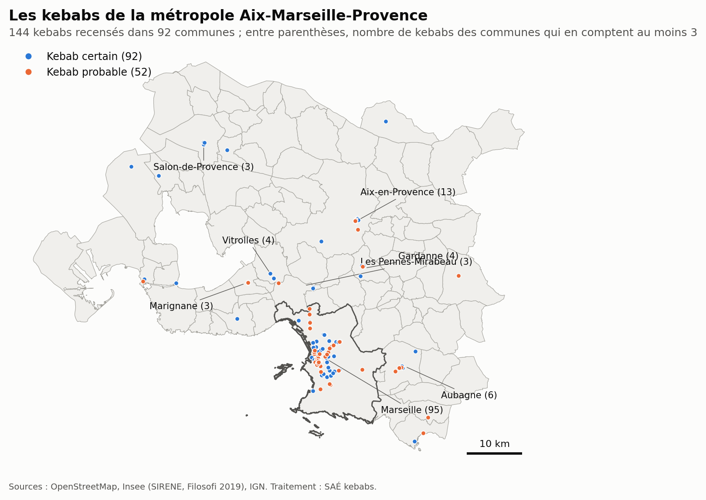

*Figure 1 : les kebabs de la métropole Aix-Marseille-Provence.*

À l'échelle de la métropole, la répartition est très inégale. Marseille concentre 95 des
144 kebabs, soit 66 %, alors qu'elle n'abrite que 46 % de la population. En dehors de
Marseille, seules 17 communes sur 91 comptent au moins un kebab. Il s'agit surtout de villes
moyennes : Aix-en-Provence (13 kebabs), Aubagne (6), Vitrolles et Gardanne (4 chacune). Les
74 communes sans kebab regroupent pourtant 472 000 habitants, principalement dans des
communes périurbaines ou rurales.

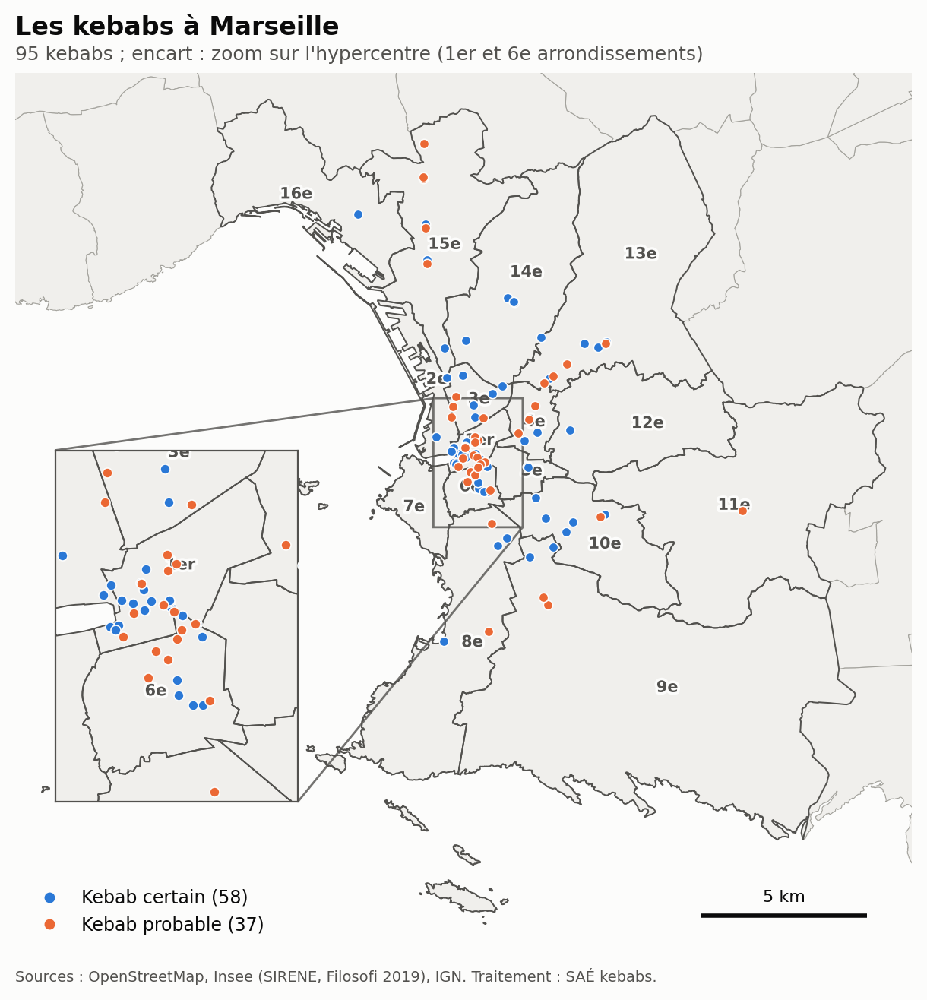

*Figure 2 : les kebabs à Marseille, avec un zoom sur l'hypercentre.*

À Marseille, les kebabs forment un noyau très dense dans les 1er et 6e arrondissements,
autour de la Canebière, de Noailles et du cours Julien. Ils s'étirent ensuite le long de deux
axes, l'un vers le nord (3e, 14e et 15e arrondissements), l'autre vers l'est (4e et 13e). Les
quartiers Sud et Est sont presque vides : on ne compte aucun kebab dans le 7e arrondissement,
et un seul dans le 11e comme dans le 12e.

## 4.2 Carroyage et densité

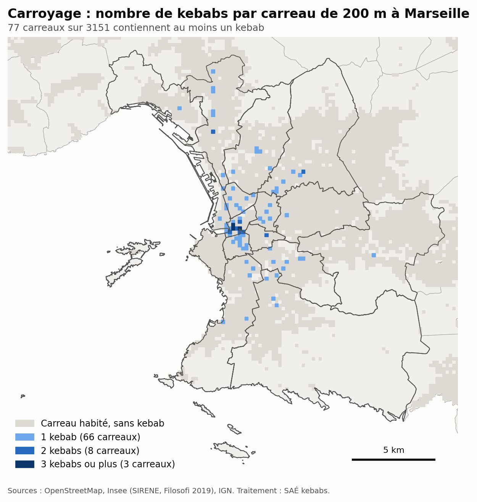

*Figure 3 : nombre de kebabs par carreau de 200 m à Marseille.*

Chaque kebab est ensuite placé dans le carreau Insee de 200 mètres qui le contient. Trois
kebabs se trouvent dans des carreaux sans habitants, comme des zones commerciales : nous
avons ajouté ces carreaux pour ne pas les perdre. À Marseille, seuls 77 carreaux sur 3 151,
soit 2,4 %, contiennent un kebab. La plupart (66) n'en ont qu'un, et trois carreaux de
l'hypercentre en ont trois ou plus, jusqu'à six. La variable que nous cherchons à expliquer
est donc presque toujours nulle, ce qui orientera le choix du modèle.

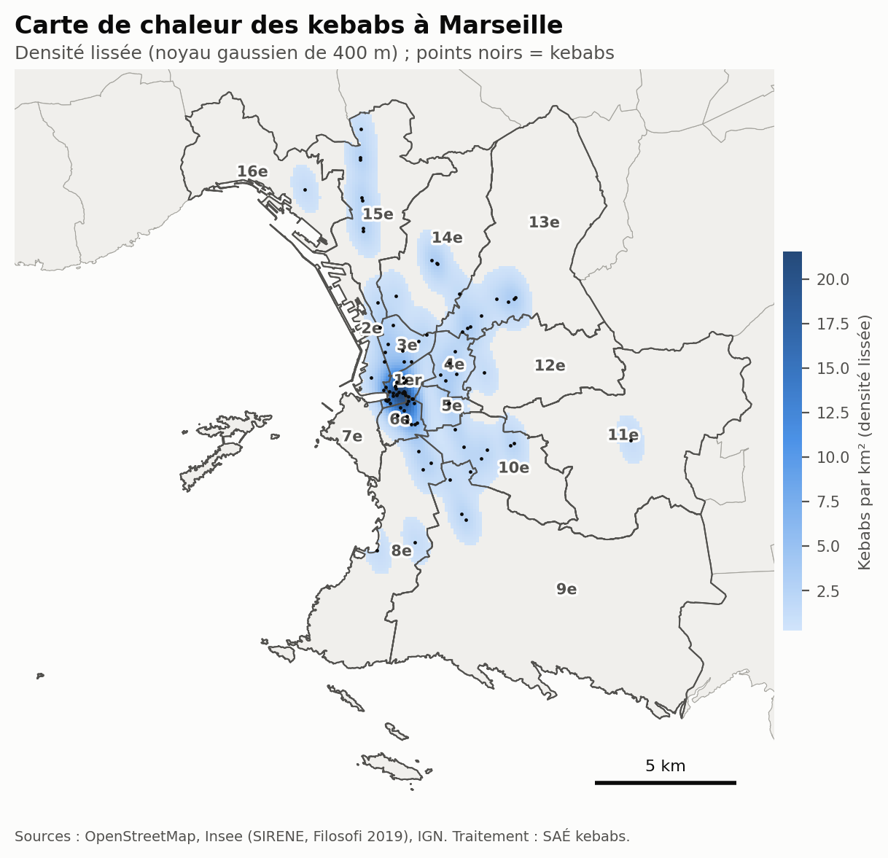

*Figure 4 : densité lissée des kebabs à Marseille.*

La carte de chaleur lisse la position des kebabs sur environ 400 mètres, soit quelques
minutes de marche. Elle fait ressortir un pôle unique et très marqué dans l'hypercentre, avec
plus de 20 kebabs au km², et quelques pôles secondaires plus modestes, à Saint-Just et
Malpassé au nord-est, et vers la Timone et Baille au sud-est.

## 4.3 Rapporter à la population

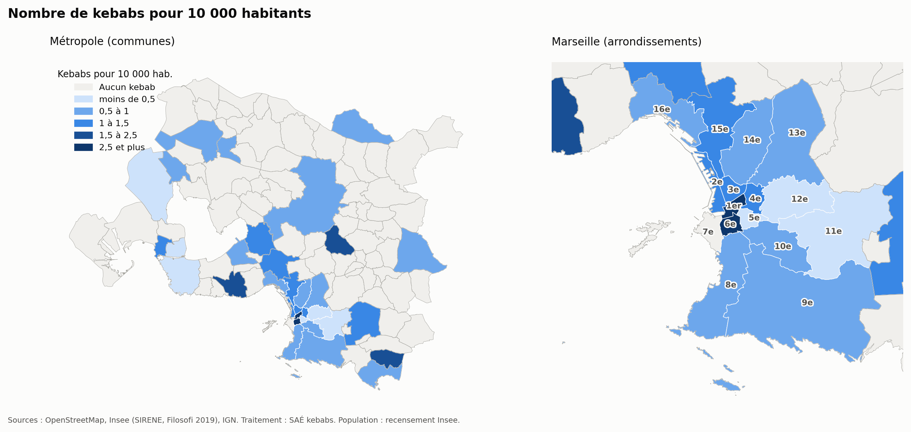

*Figure 5 : nombre de kebabs pour 10 000 habitants, par commune et par arrondissement.*

*Tableau 3 : kebabs par arrondissement de Marseille*

| Arrondissement | Kebabs | Population | Kebabs pour 10 000 hab. |
|---|---|---|---|
| 1er | 23 | 37 599 | 6,1 |
| 2e | 3 | 24 378 | 1,2 |
| 3e | 8 | 58 029 | 1,4 |
| 4e | 5 | 49 363 | 1,0 |
| 5e | 2 | 45 702 | 0,4 |
| 6e | 14 | 38 476 | 3,6 |
| 7e | 0 | 35 173 | 0,0 |
| 8e | 5 | 84 683 | 0,6 |
| 9e | 4 | 77 406 | 0,5 |
| 10e | 6 | 60 317 | 1,0 |
| 11e | 1 | 59 883 | 0,2 |
| 12e | 1 | 64 399 | 0,2 |
| 13e | 8 | 95 112 | 0,8 |
| 14e | 5 | 60 505 | 0,8 |
| 15e | 9 | 79 161 | 1,1 |
| 16e | 1 | 15 854 | 0,6 |
| Marseille | 95 | 886 040 | 1,1 |
| Reste de la métropole | 49 | 1 053 037 | 0,5 |

Même rapporté au nombre d'habitants, l'écart reste fort. Marseille compte 1,1 kebab pour
10 000 habitants, soit deux fois plus que le reste de la métropole. Les 1er et 6e
arrondissements réunissent à eux seuls 39 % des kebabs marseillais pour seulement 9 % des
habitants. La population qui vit sur place n'explique donc pas tout : l'hypercentre attire
aussi des gens de passage, avec ses commerces, sa gare et sa vie nocturne. Une opposition
entre le Nord et le Sud apparaît également, puisque les arrondissements du nord (13e à 16e)
comptent 0,9 kebab pour 10 000 habitants, deux fois plus que ceux du sud et de l'est (7e à
12e), à 0,45.

Ces taux doivent cependant être lus avec prudence dans les petites communes. À Ceyreste ou à
Ensuès-la-Redonne, un seul kebab pour environ 5 000 habitants suffit à donner un taux de
2 pour 10 000, qui n'a pas de réelle signification.

Ces premières cartes vont dans le sens de plusieurs de nos hypothèses. La concentration des
kebabs (H1) est très visible, et une double opposition, entre centre et périphérie et entre
Nord et Sud, se dessine (H4). Le pôle principal entoure par ailleurs la gare Saint-Charles,
ce qui justifie d'étudier l'effet des gares (H3). Il reste à confirmer tout cela par des
tests statistiques, ce qui fait l'objet de la partie suivante.

# 5. Croisement avec les variables socio-démographiques

## 5.1 Jointure et indicateurs

Chaque carreau de 200 mètres porte à la fois son nombre de kebabs et les sept indicateurs
décrits plus haut (section 3.5). Nous pouvons donc comparer directement les carreaux entre eux.

Avant cela, nous avons fait un choix important. Pour les carreaux de moins de 11 ménages,
l'Insee remplace les vraies valeurs par des estimations afin de respecter le secret
statistique. C'est le cas de 62 % des carreaux, mais ils ne contiennent que 7 kebabs sur 141.
Nous les avons donc écartés, pour ne travailler que sur des données réelles. Il reste
9 790 carreaux dans la métropole, dont 2 493 à Marseille. Parmi eux, 110 contiennent au
moins un kebab, dont 74 à Marseille.

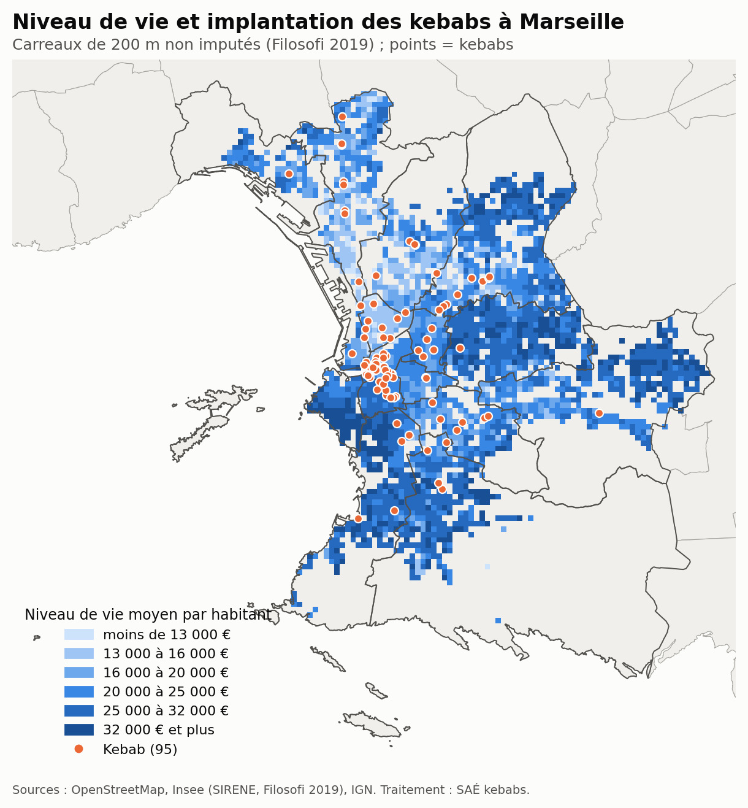

*Figure 6 : niveau de vie moyen par carreau et implantation des kebabs à Marseille.*

## 5.2 Les kebabs sont plus groupés que la population (H1)

On pourrait penser que les kebabs sont nombreux au centre simplement parce que beaucoup de
gens y habitent. Pour le vérifier, nous avons mesuré, pour chaque kebab, la distance qui le
sépare du kebab le plus proche, puis nous avons comparé la moyenne obtenue avec ce que l'on
observerait si les kebabs étaient placés au hasard là où vivent les habitants. Nous avons
simulé 999 répartitions de ce type, en tirant les carreaux en proportion de leur population.

*Tableau 4 : distance moyenne entre un kebab et le kebab le plus proche*

| Territoire | Distance observée | Distance attendue si les kebabs suivaient la population | p-valeur |
|---|---|---|---|
| Métropole | 812 m | 1 572 m | 0,001 |
| Marseille | 332 m | 575 m | 0,001 |

Les kebabs sont deux fois plus proches les uns des autres que ne le voudrait la seule
répartition des habitants. Aucune des 999 simulations n'atteint un tel regroupement, ce qui
donne une p-valeur de 0,001, la plus petite possible avec ce nombre de tirages. Notre première
hypothèse est donc confirmée : les kebabs sont plus concentrés que la population.

## 5.3 Corrélations avec les caractéristiques des carreaux (H2)

Le nombre de kebabs par carreau est presque toujours nul et sa distribution est très
déséquilibrée. Nous utilisons donc la corrélation de Spearman, qui repose sur le classement
des valeurs et non sur les valeurs elles-mêmes, plutôt que celle de Pearson. Comme nous
réalisons 14 tests (7 indicateurs sur 2 territoires), nous appliquons la correction de Holm,
qui évite de trouver des liens significatifs par simple effet du hasard.

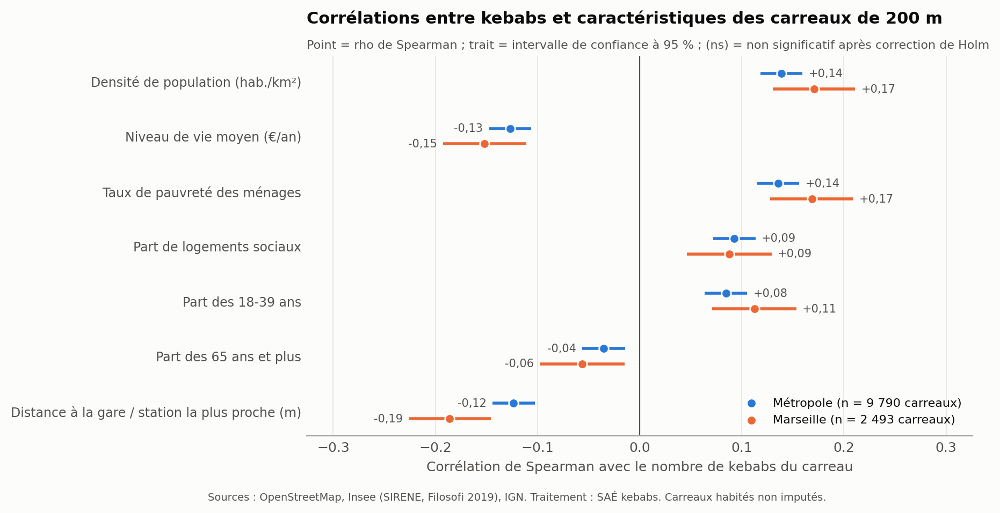

*Figure 7 : corrélations de Spearman entre le nombre de kebabs et les indicateurs des carreaux.*

Toutes les corrélations sont significatives après correction, et elles vont dans le même sens
à Marseille et dans l'ensemble de la métropole. Les kebabs sont plus nombreux dans les
carreaux denses, pauvres, jeunes et proches d'une gare ou d'une station, et plus rares dans
les carreaux aisés et âgés.

Ces corrélations restent toutefois faibles, la plus forte atteignant 0,19. Ce n'est pas
étonnant : entre 97 et 99 % des carreaux n'ont aucun kebab, ce qui réduit mécaniquement les
coefficients. La comparaison directe entre carreaux avec et sans kebab est plus parlante.
Toutes les différences présentées ci-dessous sont significatives (test de Mann-Whitney).

*Tableau 5 : valeurs médianes des carreaux avec et sans kebab, à Marseille*

| Indicateur | Carreaux avec kebab | Carreaux sans kebab |
|---|---|---|
| Densité de population | 16 600 hab./km² | 4 500 hab./km² |
| Niveau de vie moyen | 19 400 € | 24 500 € |
| Taux de pauvreté des ménages | 28 % | 13 % |
| Part des 18-39 ans | 29 % | 24 % |
| Distance à la gare ou station la plus proche | 245 m | 1 080 m |

Le logement social fait figure d'exception, avec la corrélation la plus faible. Les kebabs
s'installent bien dans des quartiers pauvres, mais pas dans les grands ensembles de logements
sociaux des quartiers Nord. On les trouve surtout dans le centre ancien, à Noailles, à
Belsunce ou le long de la Canebière, où les ménages modestes sont logés dans un parc privé
souvent dégradé.

Il faut cependant se méfier d'un effet confondant. Densité, pauvreté et proximité des gares
augmentent toutes en se rapprochant du centre-ville. Ces indicateurs sont donc liés entre eux,
et chaque corrélation reflète en partie la même opposition entre centre et périphérie. Pour
isoler l'effet propre de chacun, nous avons calculé à Marseille des corrélations partielles,
c'est-à-dire à distance égale du Vieux-Port. Elles diminuent nettement mais restent
significatives pour le niveau de vie (-0,12), la pauvreté (0,12), la proximité des gares
(-0,11) et la densité (0,09). En revanche, le lien avec le logement social disparaît presque
(0,04). La deuxième hypothèse est donc confirmée pour la pauvreté, la densité et l'âge, mais
pas pour le logement social. La modélisation (partie 6) permettra d'estimer plus précisément
le poids de chaque facteur.

## 5.4 L'âge des habitants, les 25-39 ans plutôt que les étudiants

L'indicateur « part des 18-39 ans » mélange deux publics bien différents : les étudiants, qui
ont pour la plupart entre 18 et 24 ans, et les jeunes actifs, entre 25 et 39 ans. Pour savoir
lequel des deux compte, nous avons repris l'analyse avec les dix tranches d'âge de l'Insee.
Pour chacune, nous comparons sa part dans la population des carreaux avec et sans kebab, et
nous calculons sa corrélation avec le nombre de kebabs, toujours avec la correction de Holm.

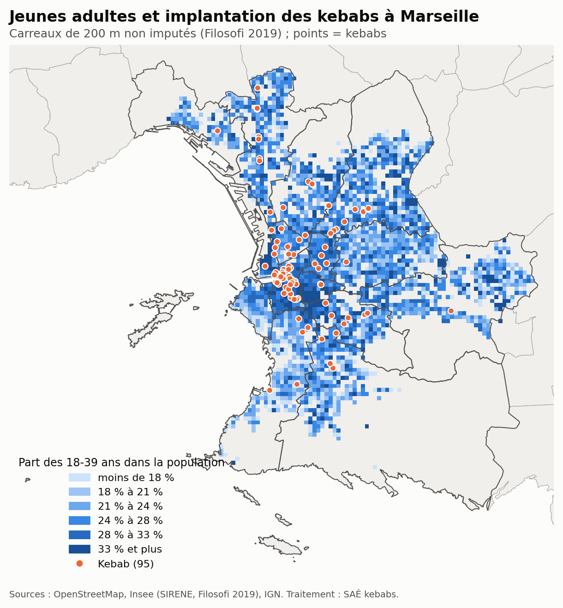

*Figure 8 : part des 18-39 ans par carreau et implantation des kebabs à Marseille.*

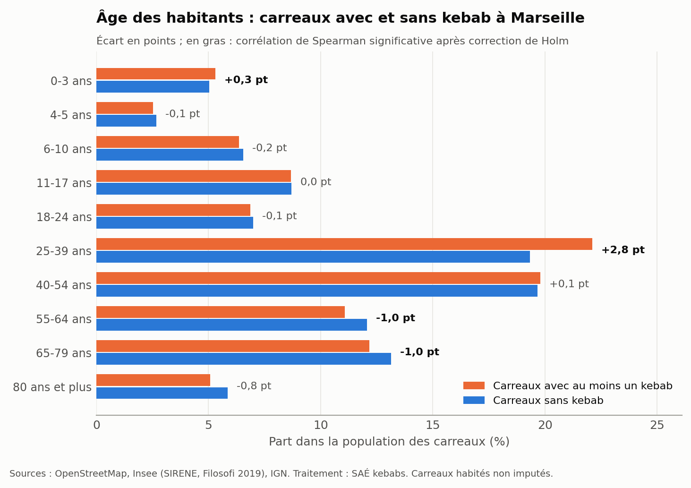

*Figure 9 : âge des habitants des carreaux avec et sans kebab, à Marseille.*

Le résultat est net : seule la tranche des 25-39 ans est plus présente autour des kebabs. Elle
représente 22,1 % des habitants des carreaux avec kebab, contre 19,3 % ailleurs, soit un
écart de 2,8 points à Marseille et de 4,1 points dans la métropole. Les 18-24 ans, eux, ne font
aucune différence (6,9 % contre 7,0 %). Les 55-79 ans sont légèrement moins présents, d'environ
un point par tranche. On note enfin un peu plus de très jeunes enfants (0-3 ans), ce qui
correspond aux enfants de ces jeunes ménages.

Contrairement à une idée répandue, le kebab n'est donc pas, à Marseille, un commerce
d'étudiants. Il s'implante plutôt là où vivent de jeunes actifs, souvent dans les petits
logements du centre ancien. Deux réserves s'imposent toutefois. Les étudiants sont parfois
recensés chez leurs parents, ce qui peut les sous-estimer dans les quartiers du centre. Et
l'âge reste étroitement lié à la densité et à la pauvreté, un effet que la modélisation devra
démêler.

## 5.5 Fractures Nord-Sud et centre-périphérie à Marseille (H4)

Pour tester ces fractures, nous comparons le nombre de kebabs par habitant entre groupes
d'arrondissements à l'aide d'un test binomial exact. L'idée est simple : si les kebabs
suivaient la population, chaque groupe d'arrondissements aurait une part des kebabs égale à
sa part des habitants.

*Tableau 6 : kebabs pour 10 000 habitants selon les groupes d'arrondissements*

| Comparaison | Kebabs pour 10 000 hab. | p-valeur |
|---|---|---|
| Nord (13e-16e) et Sud-Est (7e-12e) | 0,92 contre 0,45 | 0,024 |
| Centre (1er-6e) et Nord (13e-16e) | 2,17 contre 0,92 | < 0,001 |

Les deux écarts sont significatifs. Les quartiers Nord comptent deux fois plus de kebabs par
habitant que le Sud et l'Est, et le centre en compte plus de deux fois plus que le Nord. Notre
quatrième hypothèse est donc confirmée : la carte des kebabs suit le gradient social de
Marseille, avec un centre populaire et des quartiers Nord plus pauvres que le Sud aisé. Il
s'agit néanmoins d'une association, et non d'un lien de cause à effet.

## 5.6 Effet des gares et carte isochrone (H3)

Où sont les gares par rapport aux kebabs ? La figure 11 superpose les kebabs marseillais et
les 132 gares et stations du périmètre : gares SNCF et TER, stations de métro et arrêts de
tramway. Les kebabs suivent nettement les lignes de transport, en particulier le métro et le
tram du centre-ville, alors que les gares SNCF des quartiers périphériques n'en attirent que
peu.

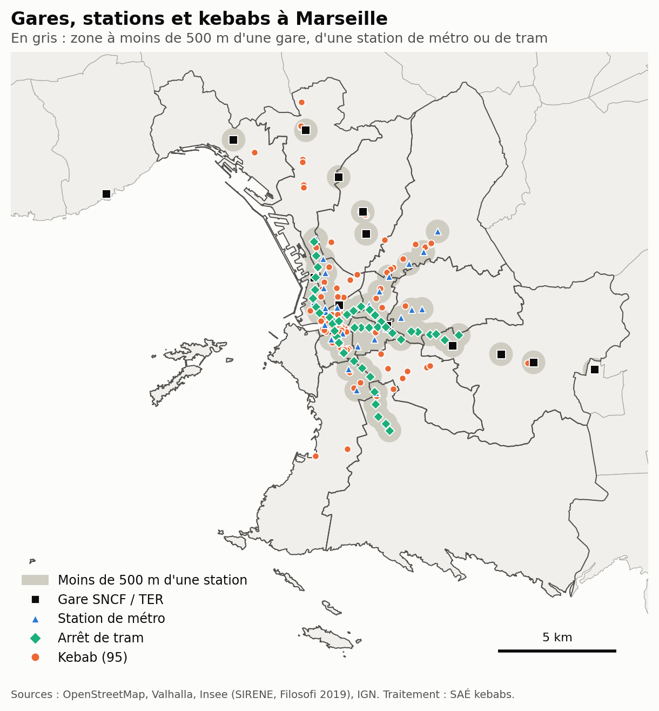

*Figure 11 : gares, stations de métro, arrêts de tram et kebabs à Marseille.*

Pour le vérifier, nous mesurons la distance de chaque kebab à la gare ou à la station la
plus proche, et nous la comparons à celle qu'auraient des kebabs placés au hasard chez les
habitants (999 simulations, comme pour le test de la section 5.2). Nous testons deux
définitions de la gare, car c'est un choix qui peut changer le résultat : les gares SNCF
seules, puis toutes les stations.

*Tableau 8 : distance des kebabs et des habitants à la gare la plus proche, à Marseille*

| Définition de la gare | Distance médiane des kebabs | Si les kebabs suivaient la population | p-valeur | Kebabs à moins de 500 m | Habitants à moins de 500 m |
|---|---|---|---|---|---|
| Gares SNCF et TER | 1 170 m | 1 630 m | 0,003 | 15 % | 8 % |
| Toutes les stations | 230 m | 700 m | 0,001 | 78 % | 39 % |

Les kebabs sont nettement plus proches des gares que les habitants, et l'écart est encore
plus fort avec les stations de métro et de tram. À Marseille, 78 % des kebabs se trouvent
à moins de 500 mètres d'une station, contre 39 % des habitants. Le résultat est le même à
l'échelle de la métropole (60 % contre 22 %). La troisième hypothèse est donc confirmée :
les kebabs recherchent les lieux de passage, et c'est la proximité du métro et du tram, plus
que celle des grandes gares, qui compte.

La carte isochrone précise ce résultat autour de la principale gare, Saint-Charles. Elle
montre les zones que l'on peut atteindre à pied en 5, 10 et 15 minutes, en suivant le
réseau réel des rues et des escaliers, et non à vol d'oiseau. Ces zones ont été calculées
avec le service libre Valhalla, qui s'appuie sur les données d'OpenStreetMap.

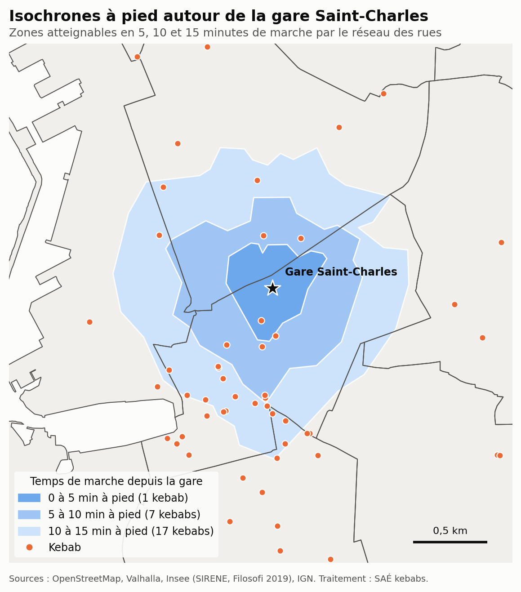

*Figure 10 : zones atteignables à pied en 5, 10 et 15 minutes depuis la gare Saint-Charles.*

*Tableau 7 : kebabs et habitants selon le temps de marche depuis la gare Saint-Charles*

| Temps de marche | Kebabs | Habitants | Kebabs pour 10 000 hab. |
|---|---|---|---|
| Moins de 5 min | 1 | 2 300 | 4,4 |
| 5 à 10 min | 7 | 18 000 | 3,9 |
| 10 à 15 min | 17 | 38 000 | 4,5 |
| Reste de Marseille | 70 | 752 000 | 0,9 |

Un quart des kebabs marseillais (25 sur 95) se trouvent à moins de 15 minutes à pied de la
gare, alors que cette zone n'abrite que 7 % des habitants de la ville. Rapporté à la
population, on y compte près de cinq fois plus de kebabs qu'ailleurs. Il y a cependant une
nuance : un seul kebab se trouve à moins de 5 minutes de la gare. Saint-Charles est perchée
sur une butte, entourée de voies ferrées et de bâtiments universitaires. Les kebabs se
concentrent plutôt entre 10 et 15 minutes de marche, en descendant vers Noailles, Belsunce
et la Canebière. Ce n'est donc pas la gare elle-même qui les attire, mais le quartier
commerçant et très fréquenté qui l'entoure.

## 5.7 Le dicton de la gare (H5)

Le dicton « plus c'est près de la gare, moins le kebab est bon » ne peut pas être testé avec
nos données, car nous ne disposons d'aucune mesure de la qualité des kebabs. OpenStreetMap et
SIRENE ne contiennent pas de notes. Les notes Google, utilisées dans les études qui ont tenté
de tester ce dicton, ne sont accessibles que par une API payante, et leur collecte
automatique est encadrée par les conditions d'utilisation du service.

Si ces notes étaient disponibles, le protocole serait le suivant. Pour chaque kebab, on
relèverait la note moyenne et le nombre d'avis. On mesurerait la distance à pied à la gare
la plus proche, plutôt que la distance à vol d'oiseau. On relierait ensuite la note à cette
distance, en tenant compte du nombre d'avis, car un kebab qui n'a que trois avis peut avoir
une note extrême par hasard. Il faudrait aussi tester un effet de seuil : la qualité pourrait
baisser seulement dans les toutes premières centaines de mètres autour de la gare.

Nos résultats apportent déjà un élément au débat. Les kebabs sont bien plus nombreux près des
gares et des stations, car ce sont des lieux de passage. Une clientèle de passage revient
peu, ce qui pourrait en théorie moins inciter à soigner la qualité. Mais cela reste une
hypothèse : seule une mesure de la qualité permettrait de trancher.

# 6. Modélisation

Les parties précédentes ont montré que les kebabs se trouvent dans des quartiers denses,
pauvres, jeunes et proches des stations. Mais ces caractéristiques vont souvent ensemble : un
quartier dense est souvent pauvre et bien desservi. La question reste donc entière : qu'est-ce
qui explique vraiment qu'un kebab s'installe à un endroit plutôt qu'à un autre ? Est-ce la
jeunesse des habitants, leur niveau de revenu, la proximité d'une gare ? Pour démêler ces
effets, nous construisons un modèle qui mesure l'effet de chaque facteur toutes choses égales
par ailleurs.

## 6.1 Le modèle

Nous utilisons une régression logistique. Pour chaque carreau de 200 mètres, elle estime la
probabilité qu'il contienne au moins un kebab, en fonction de sept caractéristiques : la
densité de population, le niveau de vie moyen, la part de logements sociaux, la part des
25-39 ans, la part des 65 ans et plus, la distance à la station la plus proche, et le fait
que le carreau soit situé à Marseille ou non. Le taux de pauvreté n'est pas retenu, car il
est presque l'inverse du niveau de vie et les deux ensemble rendraient les effets difficiles
à lire. Nous avons vérifié que les autres variables ne sont pas trop liées entre elles.

Le modèle porte sur les 9 790 carreaux de la métropole dont les données sont réelles, dont
110 contiennent un kebab. Pour comparer les effets entre eux, chaque variable est exprimée en
écarts-types : l'effet indiqué est celui d'une hausse « typique » de la variable. Il se lit
comme un multiplicateur des chances d'avoir un kebab : 2 signifie des chances doublées,
0,5 des chances divisées par deux.

## 6.2 Ce qui explique la présence d'un kebab

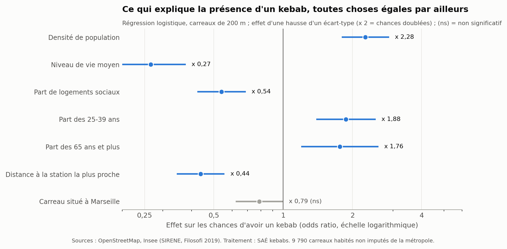

*Figure 12 : effet de chaque caractéristique sur les chances d'avoir un kebab, toutes choses
égales par ailleurs.*

*Tableau 9 : effets estimés par le modèle*

| Caractéristique du carreau | Hausse d'un écart-type | Effet sur les chances d'avoir un kebab |
|---|---|---|
| Niveau de vie moyen | + 5 500 € par an | divisées par près de 4 (x 0,27) |
| Densité de population | x 2,5 habitants | multipliées par 2,3 |
| Distance à la station la plus proche | x 2,7 en distance | divisées par 2,3 (x 0,44) |
| Part des 25-39 ans | + 7,5 points | multipliées par 1,9 |
| Part des 65 ans et plus | + 11 points | multipliées par 1,8 |
| Part de logements sociaux | + 23 points | divisées par 1,9 (x 0,54) |
| Carreau situé à Marseille | | non significatif (x 0,79) |

Le modèle répond clairement à la question de départ. Le facteur le plus déterminant est le
niveau de vie : à densité, âge et desserte égaux, les kebabs évitent les quartiers aisés.
Une hausse de 5 500 euros du niveau de vie moyen divise par près de quatre les chances de trouver un
kebab. Viennent ensuite la densité de population et la proximité d'une station, qui
traduisent le besoin d'une clientèle nombreuse et de passage. Les jeunes adultes comptent
aussi, mais moins : une part plus forte de 25-39 ans multiplie les chances par 1,9.

Deux résultats méritent une explication. À revenu égal, le logement social réduit les
chances d'avoir un kebab. Ce n'est pas contradictoire avec le reste : les kebabs s'installent
dans les quartiers modestes du centre ancien, où l'on se loge dans le parc privé, et non dans
les grands ensembles, souvent conçus sans rez-de-chaussée commerçants. L'effet positif des
65 ans et plus surprend davantage. Il faut le lire avec la part des 25-39 ans : à part de
jeunes adultes égale, plus de seniors signifie surtout moins de familles avec enfants. Ce
sont donc les quartiers familiaux et pavillonnaires qui attirent le moins les kebabs.

Enfin, une fois ces facteurs pris en compte, le fait d'être à Marseille n'a plus d'effet
propre. Les nombreux kebabs de Marseille s'expliquent donc par ses caractéristiques (densité,
pauvreté, réseau de métro et de tram), et non par un effet propre à la ville. Ces résultats
restent les mêmes lorsque l'on ne garde que les kebabs certains, ce qui montre qu'ils ne
dépendent pas de notre classement des kebabs probables.

Il faut toutefois rester prudent. Le modèle mesure des associations et non des causes : un
kebab ne s'installe pas parce que les habitants sont pauvres, mais peut-être parce que les
loyers commerciaux y sont plus bas, ou parce que la clientèle de passage y est nombreuse. De
plus, le modèle ne tient pas compte du fait que des carreaux voisins se ressemblent (on parle
d'autocorrélation spatiale), ce qui peut rendre les intervalles de confiance un peu trop
étroits.

## 6.3 Qualité du modèle

Pour juger le modèle, nous le testons sur des carreaux qu'il n'a pas vus pendant son
apprentissage : c'est la validation croisée. Les carreaux sont répartis en cinq groupes ; le
modèle apprend sur quatre et prédit le cinquième, et l'opération est répétée 10 fois.

*Tableau 10 : performances du modèle en validation croisée*

| Modèle | AUC | F1-score | Précision | Rappel |
|---|---|---|---|---|
| Modèle complet | 0,93 | 0,22 | 18 % | 31 % |
| Densité de population seule | 0,88 | 0,13 | 8 % | 29 % |

L'AUC mesure la capacité du modèle à classer les carreaux : elle vaut 0,5 pour un modèle qui
tirerait au hasard et 1 pour un modèle parfait. Avec 0,93, notre modèle distingue très bien
les carreaux qui ont un kebab de ceux qui n'en ont pas. Il fait nettement mieux que la seule
densité de population (0,88), ce qui confirme que le revenu, l'âge et les stations apportent
une information réelle.

Le F1-score, en revanche, est faible (0,22). Sur une validation, le modèle signale en moyenne
188 carreaux comme « à kebab » : 34 en ont réellement un, et 154 n'en ont pas. Il retrouve
ainsi 34 des 109 carreaux qui ont un kebab. Ce résultat modeste s'explique d'abord par la
rareté des kebabs : à peine plus d'un carreau sur cent en contient un, ce qui rend toute
prédiction exacte très difficile. Ensuite, beaucoup de « fausses alertes » sont sans doute de
vrais emplacements de kebabs absents de notre base, qui n'en couvre qu'environ un tiers
(section 3.3). Le modèle est donc bon pour repérer les quartiers favorables aux kebabs, mais
il ne permet pas de dire dans quelle rue précise un kebab s'installera.

# 7. Retour et recommandations

[À FAIRE : difficultés rencontrées dans le traitement des données et pistes d'amélioration.]

# 8. Conclusion

[À FAIRE : réponse à la problématique et ouverture.]

# Bibliographie et sources

Les Échos, *Ce que la carte des kebabs révèle de Paris*, vidéo.

Insee, *Revenus, pauvreté et niveau de vie en 2019 : données carroyées (Filosofi)*.

OpenStreetMap et ses contributeurs, données extraites avec l'API Overpass.

Insee et DINUM, *API Recherche d'entreprises* (répertoire SIRENE).

IGN et Insee, *API Découpage administratif* (geo.api.gouv.fr).

[À compléter : articles et ressources sur le dicton « kebab et gare ».]

# Annexes

## A. Diagramme de Gantt prévisionnel

[À FAIRE : insérer le diagramme de Gantt.]

## B. Code source

L'ensemble du traitement est réalisé en Python. Les scripts, commentés et reproductibles, se
trouvent dans le dossier scripts du projet et s'exécutent dans l'ordre de leur numéro.

| Script | Rôle |
|---|---|
| 00_lancer_collecte.py | Lance toute la collecte (scripts 01 à 05) |
| 01_collecte_limites.py | Limites des communes et arrondissements, découpage en 107 zones |
| 02_collecte_kebabs_osm.py | Kebabs d'OpenStreetMap |
| 03_collecte_kebabs_sirene.py | Kebabs du répertoire SIRENE |
| 04_collecte_gares.py | Gares SNCF, stations de métro et arrêts de tram |
| 05_collecte_insee_carreaux.py | Carreaux Insee Filosofi de 200 m |
| 06_nettoyage_kebabs.py | Fiabilité, doublons, fusion des deux sources |
| 07_cartes_exploratoires.py | Carroyage et cartes de la partie 4 |
| 08_croisement_insee.py | Indicateurs, tests et figures des sections 5.1 à 5.5 |
| 09_contributeurs_osm.py | Historique des fiches kebabs d'OpenStreetMap (section 3.6) |
| 10_gares_isochrone.py | Distance aux gares et isochrones de Saint-Charles (section 5.6) |
| 11_modelisation.py | Régression logistique et validation croisée (partie 6) |

## C. Dictionnaire des données

[À FAIRE : description des colonnes des fichiers de données brutes et traitées, et calcul
des indicateurs à partir des variables Insee (par exemple, niveau de vie moyen = somme des
niveaux de vie / nombre d'individus).]
